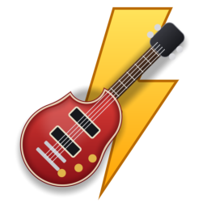
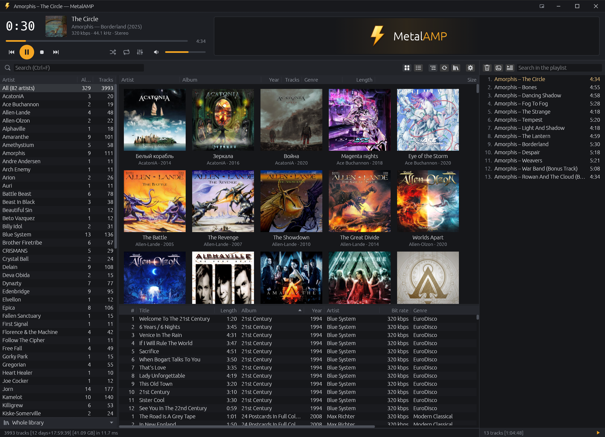

<p align="center">
  
</p>

<h1 align="center">MetalAMP</h1>

<p align="center">A fast audio player with a media library for Windows</p>

<p align="center">
  <a href="https://github.com/Fan4Metal/metalamp/releases/latest"></a>
  
  
  <a href="LICENSE"></a>
</p>

<p align="center"><b>English</b> | <a href="README.ru.md">Русский</a></p>

MetalAMP is an audio player for Windows built around a media library: the music folders are scanned once, and the artists, the albums with their covers and the tracks are then shown at once and filtered as a search is typed. Playback uses the decoders of Windows itself (Media Foundation) and the WASAPI audio output, so the program is a single executable without additional libraries, and albums meant to be heard without pauses play without gaps.



*Screenshot of version 0.1.0.*

## Features

- **A media library**: artists with their numbers of albums and tracks, a grid of album covers (or a table), the tracks; choosing an artist narrows the albums, an album the tracks; views narrow the library by rules, a genre or a folder, as Winamp's smart views (see [The library](#the-library)).
- **Fast**: a library of 4942 tracks is shown from its index in about 12 ms at start-up, and a check of its folders that finds nothing changed takes about 26 ms; a search narrows every pane in under a millisecond.
- **Gapless playback**: the next track is opened before the current one ends, and MP3 files are cut to their music by their LAME tags (see [Playback](#playback)).
- **Formats of Windows**: MP3, AAC (M4A), FLAC, WMA and WAV, decoded by Media Foundation; M3U and M3U8 playlists.
- **A playlist** beside the library, kept between runs.
- **File info**: every field of a track's tag, its cover and its audio properties, in a window opened by a click on the player's cover or `I` (see [File info](#file-info)).
- **One window**: files opened from Explorer go to the window already open.
- **File associations** with an icon for each type, offered by the installer.
- **English or Russian interface**: it follows the language of Windows and can be changed in the settings window (`F5`).
- **Portable**: the [portable archive](#installation) keeps its settings, the library index and the covers next to the program.
- **Privacy**: no network access beyond the optional update check (see [Update check and privacy](#update-check-and-privacy)).

## Installation

The installer and the portable archive are on the [Releases](https://github.com/Fan4Metal/metalamp/releases) page.

The installer, `MetalAMP_<version>_Setup.exe`, needs no administrator rights: the program is placed in `%LOCALAPPDATA%\Programs\MetalAMP`. It can register MetalAMP for audio files and playlists (MP3, FLAC, M4A, AAC, WAV, WMA, M3U), each type with its own icon; Windows lets only the user choose the default program, so the last page offers to open the Default apps settings. The installed program keeps its settings, the library index (`library.json`), the playlist (`playlist.m3u8`), the loudness measurements (`loudness.json`) and the cover thumbnails (`covers`) in `%APPDATA%\MetalAMP\config`. When the program is uninstalled, the uninstaller asks whether to delete that folder as well.

The portable archive, `MetalAMP_<version>_portable.zip`, holds the program in a `MetalAMP` folder and runs without installation. It also holds an empty `metalamp.json`. While that file is next to `metalamp.exe` and the folder is writable, the settings are kept in it and the library index, the playlist and the covers beside it, so the program can be carried on a removable drive. Without the file, the program keeps them in `%APPDATA%\MetalAMP\config`, as the installed program does. The About window shows where the settings are kept.

Windows 10 version 1607 or later is required (its FLAC decoder came with that version). The executables are not code-signed, so Windows SmartScreen may warn about an unknown publisher on first launch.

## Usage

### The library

On the first start the window offers to add a music folder: `Ctrl+Shift+O`, or a folder dropped on the window. The folders' button in the library bar lists the folders and removes one. The folders are read on a thread of their own: the tags of each file (title, artist, album artist, album, year, track and disc numbers, genre, length, bit rate) and, where a tag lacks something, what the folders say in the usual layout `Artist\(Year) Album\NN - Title.mp3`. The library fills as it is read; a first reading of 4942 MP3 files on a hard disk took about 50 seconds. The result is kept in an index, so later starts show the library at once and read again only the files whose size or time changed; `Ctrl+R` or the bar's button reads the folders again. **Read all the tags again** in the folders' menu reads every file, also those whose size and time did not change (a tagger may keep the files' time).

Albums are grouped by album artist (else artist) and album title, whatever the years of their tracks; an album's year is the earliest of them. Editions of one album in folders of their own with different years (a Greatest Hits of 1990 and of 2005) are separate albums; the discs of one album in folders of their own stay one. Artists are sorted by name with numbers in their order, each artist's albums by year.

The panes:

- **Artists**: the name, the number of albums and of tracks; **All** at the top shows the whole library.
- **Albums**: covers with the title and the year (or the artist), or a table with the artist, title, year, number of tracks, genre, length and size; the bar's two buttons switch between them. A cover is the picture in the album's folder (`folder`, `cover`, `front`, `albumart`, JPEG or PNG), else the one in the first track's tag; thumbnails are kept in the `covers` folder.
- **Tracks**: number, title, length, album, year, artist, genre, bit rate, rating, plays, the day of the last play and the day the track came into the library (for the tracks of an older index and of a library's first reading, the file's time); the track playing is shown in the colour of the controls (by default). A play counts once a track has been heard for half its length or four minutes, whichever comes first (time actually heard: a seek or a pause does not count). Ratings of one to five stars are set by the right button's **Rating** menu. Plays and ratings are kept in `stats.json` next to the settings; the music's files are not written.

A click on a column's header sorts by that column, a second click reverses the order, a third returns to the library's order; a column's right edge is dragged to change its width (a double click on it fits the column to its longest text, as in Windows' lists), and the borders between the panes move. Columns that do not fit in a pane scroll sideways (the scroll bar, or `Shift` with the mouse wheel). The search field (`Ctrl+F`) narrows all three panes as it is typed: every word must be found in the track's artist, album artist, album, title, genre or year; `Esc` clears it. The status line shows the number, the total length and the size of the tracks shown, and how long the search took.

**Views** narrow the library to the tracks that meet a set of rules, as Winamp's smart views did: the row under the artists names the view in use (**Whole library** at first) and opens the menu of the views, with **New view…** and **Edit…** for the one in use. A view has a name, an icon (a note, a clapperboard, a lightning bolt, a heart, a star, a clock, a disc, a microphone, headphones, a globe or a folder), shown before its name, and rules, all of which must hold (or any one of them): a field (genre, artist, album artist, album, title, year, folder, bit rate, length in minutes, days since the track came into the library, plays, days since the last play, rating, a cover in the tag), an operation (contains, is, starts with, is empty, less than, between, inside a folder…) and a value. Texts are compared without regard to case, and a text field's value has a menu of the values the library holds, so a genre is picked as the tags spell it. While the editor is open it says how many artists, albums and tracks the rules leave. A view "Soundtracks" with the rule *genre contains soundtrack* and a view "Everything else" with *genre does not contain soundtrack* split the library in two; an artist with albums of both kinds is in both views, with the counts of each. The search, the panes and the status line work within the view; `Ctrl+1` shows the whole library, `Ctrl+2`…`Ctrl+9` the views in the order of the menu. The views are kept in the settings.

A double click or `Enter` plays: an artist plays its tracks, an album its tracks, a track the whole table from it on. The right button opens a menu with **Play**, **Add to the playlist** and **Show in folder**, on an album also **Go to artist**, on a track also **Go to album**, **Go to artist**, **Rating** and **File info…**. Going to an album or an artist chooses them in the panes, scrolls them into sight and selects the track the menu was opened on; a search or a view that would hide them is cleared.

### File info

A click on the cover in the player bar opens the file info window of the track playing; `I` (or `Alt+3`) and **File info…** in the context menus of the tracks and of the playlist open it for the track selected. The window shows the cover (from the tag, else the album's folder) with the title, the artist, the album, its year and genre, and the format, length, bit rate, sample rate, channels and size; then the tag's fields in their usual order (track and disc numbers, title, artist, album, year, genre, album artist, composer, publisher, original artist, copyright, URL, encoded by, BPM, track and album gain, comment), empty ones as a dash, the tag's other fields under them and the tags the file holds (for example `ID3v2.3 · ID3v1`); the lyrics in a section of their own; then the file's path, the encoder delay and padding of an MP3's LAME tag and the pictures in the tag with their sizes. The fields are shown, not edited; their text can be selected and copied. The cross, `Esc`, `Enter` or a click outside closes the window; **Show in folder** in the file section selects the file in Explorer.

### Playback

The player bar, in its default layout, has the player on the left and a visualization on the right. On the left: the time played in large digits (a click switches it to the time left, and back), the cover, the title, the artist and album, the bit rate, sample rate and channels; the seek bar with the length at its end; Previous, Play/Pause, Stop and Next; shuffle, repeat (off, the playlist, the track), the equalizer and the volume with a mute button. The equalizer's button is lit while the equalizer is on and opens it in a window of its own under the button (the same equalizer as in the settings window), which the cross, `Esc` or the button close. On the right, in the room left, a visualization of the sound heard: a spectrum analyzer with peaks that hold and fall, a waveform rolling from the right, an oscilloscope, a spectrogram, or none; a click on it goes on to the next one, and the right button lists them. The mouse wheel anywhere over the title row and the player bar changes the volume in steps of 5 %. The taskbar button shows the position as its progress (yellow when paused) and has Previous, Play/Pause and Next under its thumbnail. The media keys of keyboards, headsets and remotes control the player also while another window is active, and Windows' media panel by the volume shows the track; the settings window can limit them to the player's window or turn them off. The settings window offers the compact bar of one row instead: the buttons, the cover and the names, shuffle, repeat, the equalizer and the volume, with the seek bar and the times under them.

Media Foundation, the media framework of Windows, decodes the files, and the WASAPI shared mode plays them on the default device or the one chosen in the settings; a change of the default device or a device unplugged is followed without stopping. The track after the current one is opened in advance, so tracks of one format follow each other without a pause. An MP3 encoder adds silence before the music and after it; MetalAMP reads how much from the file's LAME tag and leaves it out, so an album recorded without pauses plays as one piece.

The sound can be processed on its way to the device, all of it off by default and switched on in the settings window. **The same loudness for every track** measures a track after EBU R128 in the background before its first play (the measurement is kept, so each track is read once) and brings it to −18 LUFS, a quiet track only as far as its peaks allow. The **equalizer** has the ten classic bands and a preamp, Flat and the classic presets (Rock, Pop, Classical and the rest) and the user's own, saved under a name. The **enhancer** has four amounts of 0 to 10: bass (a shelf under 100 Hz and the harmonics of the bass, which small speakers make heard as bass they cannot play), clarity (the air over 6 kHz an MP3's low-pass took away), width (a wider stereo image, the bass kept in the middle) and warmth (a soft rounding of the peaks, as tape does). Whenever any of these is on, a look-ahead limiter after them keeps the sound from clipping, holding the peaks at −1 dBFS; a raised preamp then makes a loud track denser rather than louder. The limiter can be turned off: raised bands and preamp are then heard as raised, what goes past full scale is clipped by Windows, and loudness normalisation raises a quiet track only up to full scale. The spectrum analyzer shows the result.

### Settings

The settings window (`F5`, or `Ctrl+P`, or the gear in the library's bar) holds the interface language, the theme (five dark ones and two light ones, from black to white), the colour of the controls (nine ready ones or one's own, picked or typed as HEX, RGB or HSL), the colours of the selection and of the track playing (each from the colour of the controls, grey, slate, blue, teal, purple or one's own; the track playing also the brightest, white on a dark theme), the layout of the player bar, the sound output device (Windows' default, which follows the device chosen in Windows, or one of the devices present; a chosen device that is absent when a track starts is replaced by the default one until it is back), the sound processing (loudness, the equalizer, the enhancer) and the update check. **Reset** puts them back to their defaults.

### The playlist

The playlist on the right (`Alt+E` shows or hides it) lists "Artist – Title" with the length of each entry and the total at the bottom; its search field narrows the list. Entries are selected with `Ctrl` and `Shift`, dragged to another place, removed with `Delete`; a double click or `Enter` plays one. The right button's menu also has **Go to album** and **Go to artist**, which show an entry's album or artist in the library. Under the list the cover of the track playing is shown, as large as the panel allows; the picture button in the playlist's bar hides it, and a click on it opens the file info. Files dropped on the window are added to the playlist; `Ctrl+O` opens files instead of it. M3U and M3U8 playlists open as their entries. The playlist is kept between runs as `playlist.m3u8`.

## Keyboard shortcuts

| Key | Action |
|---|---|
| `Space`, `C` | Play / pause |
| `X` | Play |
| `V` | Stop |
| `Ctrl+Right`, `B` | Next track |
| `Ctrl+Left`, `Z` | Previous track (the start of the current one after its first 3 seconds) |
| `Shift+Right` / `Shift+Left`, or `Right` / `Left` with the pointer over the player bar | 5 seconds forward / back |
| `Ctrl+Up` / `Ctrl+Down`, or `Up` / `Down` with the pointer over the player bar | Volume up / down |
| `M` | Mute |
| `R` | Repeat: off, the playlist, the track |
| `S` | Shuffle |
| `Ctrl+F` | Search the library |
| `Ctrl+1` … `Ctrl+9` | The whole library (`1`) or one of its views, in the order of the views' menu |
| `Ctrl+O` | Open files |
| `Ctrl+Shift+O` | Add a music folder |
| `Ctrl+R` | Read the library's folders again |
| `Alt+E` | Show or hide the playlist |
| `I`, `Alt+3` | File info of the selected track (else of the one playing) |
| Arrows, `Page Up`, `Page Down`, `Home`, `End` | Move in the pane clicked last |
| Letters, with the pointer over the artists | Go to the first artist starting with them (the same letter again goes on to the next one) |
| `Enter` | Play the selection |
| `Delete` | Remove from the playlist |
| `F1` | About (also a click on the icon in the title row) |
| `Ctrl` + wheel over the covers | Larger or smaller covers (also the right button on the covers' button in the library bar: four sizes and a slider) |
| `F5`, `Ctrl+P` | Settings (also the gear in the library's bar) |

The media keys of keyboards, headsets and remotes work also while another window is active; the settings window can limit them to the player's window or turn them off.

## Update check and privacy

The update check is optional and off by default. With **Check at start-up** enabled on the Updates page of the settings window, the program asks the GitHub Releases API (`api.github.com`) for the latest release at most once a day; **Check now** in the same window asks at once. The request carries nothing but the program version in its `User-Agent` header, and nothing is downloaded or installed: when a newer release exists, a button with its version appears in the title row and opens the release page in the browser. Otherwise the program does not access the network.

## Building

Requirements: Windows 10 or later, a stable Rust toolchain (MSVC target, 2024 edition) and the Visual Studio 2022 Build Tools with the C++ workload. For `build.py`, [uv](https://docs.astral.sh/uv/).

```
uv run build.py          # target\release\metalamp.exe
cargo test
```

`build.py` first closes a `metalamp.exe` running from the project's `target` folder, because it would lock the file, then runs `cargo build --release`. When the program is not running, plain `cargo build --release` works as well. The executable links the C runtime statically (`.cargo/config.toml`), so it needs nothing beyond Windows itself.

Three measurements are built in: `metalamp --bench scan <folder>` reads a folder as a first scan does and prints the times, `metalamp --bench gapless <file.mp3>` compares what the decoder gives with the file's LAME tag, and `metalamp --bench loudness <file>` measures the file's loudness (EBU R128), its peak and the gain of normalisation.

## Installer and release

The release script builds the executable, the installer and the portable archive. It needs [Inno Setup 6](https://jrsoftware.org/isinfo.php).

```
python tools/make_release.py              # tests, release build, installer, archive
python tools/make_release.py --no-tests   # the same without cargo test
python tools/make_release.py --install    # then a silent installation over the installed copy
```

The script writes the files to `dist` and takes the version from `Cargo.toml`. The installer script is `tools/setup.iss`; `metalamp.exe --export-icon <file.ico>` writes the installer icon, and `metalamp.exe --register` / `--unregister` register the file types for the current user (the installer runs them).

Releases on GitHub are built by the **Release** workflow (`.github/workflows/release.yml`). After the version in `Cargo.toml` is updated and committed, pushing a matching tag publishes a release with the installer and the portable archive:

```
git tag v0.1.0
git push origin v0.1.0
```

The workflow stops if the tag does not match the version in `Cargo.toml`. Running the workflow manually (Actions → Release → Run workflow) builds the files and attaches them to the run, without making a release.

## Built with

MetalAMP is built on the following open-source projects:

- [egui / eframe](https://github.com/emilk/egui): the user interface and the window;
- [lofty](https://github.com/Serial-ATA/lofty-rs): reading tags and audio properties;
- [image](https://github.com/image-rs/image): decoding covers and writing their thumbnails;
- [walkdir](https://github.com/BurntSushi/walkdir) and [rayon](https://github.com/rayon-rs/rayon): walking the folders and reading tags in parallel;
- [serde](https://serde.rs) and [serde_json](https://github.com/serde-rs/json): the settings and the library index;
- [windows-rs](https://github.com/microsoft/windows-rs): Media Foundation, WASAPI and the Win32 API;
- [rfd](https://github.com/PolyMeilex/rfd): the file and folder dialogs;
- [Inno Setup](https://jrsoftware.org/isinfo.php): the installer.

## License

MIT, see [LICENSE](LICENSE). The libraries compiled into the program and the fonts of its interface keep their own licences: [licenses/THIRD_PARTY_NOTICES.txt](licenses/THIRD_PARTY_NOTICES.txt), also shown by **Licenses…** in the About window and shipped with the installer and the portable archive.
