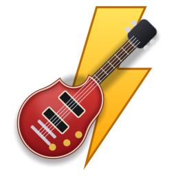
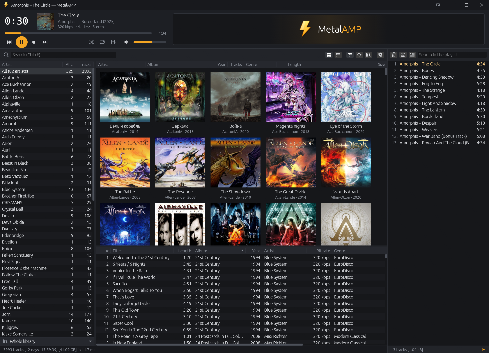

<p align="center">
  
</p>

<h1 align="center">MetalAMP</h1>

<p align="center">A fast audio player with a media library for Windows</p>

<p align="center">
  <a href="https://github.com/Fan4Metal/metalamp/releases/latest"></a>
  
  
  <a href="LICENSE"></a>
</p>

<p align="center"><b>English</b> | <a href="README.ru.md">Русский</a></p>

MetalAMP is an audio player for Windows built around a media library: the music folders are scanned once, and the artists, the albums with their covers and the tracks are then shown at once and filtered as a search is typed. Playback uses the decoders of Windows itself (Media Foundation) and the WASAPI audio output, so the program is a single executable without additional libraries, and albums meant to be heard without pauses play without gaps.



*Screenshot of version 0.1.0.*

## Features

- **A media library**: artists with their numbers of albums and tracks, a grid of album covers (or a table), the tracks; choosing an artist narrows the albums, an album the tracks; views narrow the library by rules, a genre or a folder, as Winamp's smart views (see [The library](#the-library) and [Views](#views)).
- **Fast**: a library of 4942 tracks is shown from its index in about 12 ms at start-up, and a check of its folders that finds nothing changed takes about 26 ms; a search narrows every pane in under a millisecond.
- **Gapless playback**: the next track is opened before the current one ends, and MP3 files are cut to their music by their LAME tags (see [Playback](#playback)).
- **Formats of Windows**: MP3, AAC (M4A), FLAC, WMA and WAV, decoded by Media Foundation; M3U and M3U8 playlists.
- **Sound processing**: the same loudness for every track, a ten-band equalizer, an enhancer, crossfade and a limiter, all off by default (see [Sound processing](#sound-processing)).
- **Visualizations**: spectrum analyzers, ridges, a spectrogram, synthwave, lightning, a vortex, fire, fireworks, an aurora, a cloth, ripples, ribbons, a waveform, an oscilloscope, a goniometer, the notes, a piano, guitar strings and a harp (see [Visualizations](#visualizations)).
- **A playlist** beside the library, kept between runs, and saved playlists (see [The playlist](#the-playlist)).
- **Library statistics**: the numbers of tracks, albums, artists and genres, the length and size, the plays, and charts of the bit rates, formats, years, genres, artists and the tracks played most (see [Statistics](#statistics)).
- **File info and tags**: every field of a track's tag, its cover and its audio properties, in a window opened by a click on the player's cover or `I`, where the tags of one file or of several are also edited (see [File info](#file-info)).
- **Mini player**: the cover, or a turning vinyl record, in a small window over the others (see [Mini player](#mini-player)).
- **One window**: files opened from Explorer go to the window already open.
- **File associations** with an icon for each type, offered by the installer.
- **English or Russian interface**: it follows the language of Windows and can be changed in the settings window (`F5`).
- **Portable**: the [portable archive](#installation) keeps its settings, the library index and the covers next to the program.
- **Privacy**: no network access beyond the optional update check (see [Update check and privacy](#update-check-and-privacy)).

## Installation

The installer and the portable archive are on the [Releases](https://github.com/Fan4Metal/metalamp/releases) page. Windows 10 version 1607 or later is required (its FLAC decoder came with that version). The executables are not code-signed, so Windows SmartScreen may warn about an unknown publisher on first launch.

- **Installer**, `MetalAMP_<version>_Setup.exe`: needs no administrator rights; the program is placed in `%LOCALAPPDATA%\Programs\MetalAMP` and keeps its data in `%APPDATA%\MetalAMP\config`. It can register MetalAMP for audio files and playlists (MP3, FLAC, M4A, AAC, WAV, WMA, M3U), each type with its own icon; Windows lets only the user choose the default program, so the last page offers to open the Default apps settings. When the program is uninstalled, the uninstaller asks whether to delete its data as well.
- **Portable archive**, `MetalAMP_<version>_portable.zip`: the program in a `MetalAMP` folder, run without installation; its data is kept next to it, so it can be carried on a removable drive.

<details>
<summary>What the program keeps, and where</summary>

The installed program keeps its settings, the library index (`library.json`), the playlist (`playlist.m3u8`), the saved playlists (`playlists`), the plays and ratings (`stats.json`), the loudness measurements (`loudness.json`) and the cover thumbnails (`covers`) in `%APPDATA%\MetalAMP\config`.

The portable archive holds an empty `metalamp.json`. While that file is next to `metalamp.exe` and the folder is writable, the settings are kept in it and the rest beside it. Without the file, the program keeps them in `%APPDATA%\MetalAMP\config`, as the installed program does. The About window shows where the settings are kept.

</details>

## Usage

### The library

On the first start the window offers to add a music folder: `Ctrl+Shift+O`, or **Add a folder…** in the folders' menu of the library bar. The library has three panes: the artists on the left, the albums (covers or a table) at the top right and the tracks under them; choosing an artist narrows the albums, an album the tracks. The search field (`Ctrl+F`) narrows all three panes as it is typed. A double click or `Enter` plays.

<details>
<summary>Reading the folders, the index, watching the folders</summary>

- **Folders**: the folders' button in the library bar lists the folders and removes one. The folders are read on a thread of their own: the tags of each file (title, artist, album artist, album, year, track and disc numbers, genre, length, bit rate) and, where a tag lacks something, what the folders say in the usual layout `Artist\(Year) Album\NN - Title.mp3`. The library fills as it is read; a first reading of 4942 MP3 files on a hard disk took about 50 seconds.
- **Index**: the result is kept in an index, so later starts show the library at once and read again only the files whose size or time changed.
- **Watching**: the folders are watched while the program runs: files added, changed or removed are taken in about three seconds after the folders come to rest (a copied album is read once, at the end).
- **Reading again**: the bar's button reads the folders again by hand (a key can be given to it on the settings' Keyboard shortcuts page), for example after a disk is plugged in. **Read all the tags again** in the folders' menu reads every file, also those whose size and time did not change (a tagger may keep the files' time).

</details>

<details>
<summary>How albums are grouped and sorted</summary>

Albums are grouped by album artist (else artist) and album title, whatever the years of their tracks. When no track of a folder's album has an album artist, the artist does not split it: a compilation (at least three tracks by at least three artists, none with more than half of them) is filed under **Various Artists**, and an artist's album with guests ("A", "A feat. B", "A & C") under that artist; an album's year is the earliest of them. Editions of one album in folders of their own with different years (a Greatest Hits of 1990 and of 2005) are separate albums; the discs of one album in folders of their own stay one. Artists are sorted by name with numbers in their order, each artist's albums by year.

</details>

<details>
<summary>The panes, the columns, the search, plays and ratings</summary>

- **Artists**: the name, the number of albums and of tracks; **All** at the top shows the whole library.
- **Albums**: covers with the title and the year (or the artist), or a table with the artist, title, year, number of tracks, genre, length and size; a button on the bar shows the view in use and switches to the other one (its right button lists both and sets the covers' size; so do `Ctrl` and the wheel over the covers). By default, a cover comes from the first track with an embedded picture, with the album's folder (`folder`, `cover`, `front`, `albumart`, JPEG or PNG) as a fallback. **General → Covers → Source priority** can put the folder first; a missing or unreadable picture falls back to the other source. Thumbnails are kept in the `covers` folder.
- **Tracks**: number, title, length, album, year, artist, genre, bit rate, rating, plays, the day of the last play and the day the track came into the library (for the tracks of an older index and of a library's first reading, the file's time); the track playing is shown in the colour of the controls (by default).
- **Plays and ratings**: a play counts once a track has been heard for half its length or four minutes, whichever comes first (time actually heard: a seek or a pause does not count). Ratings of one to five stars are set by the right button's **Rating** menu. Plays and ratings are kept in `stats.json` next to the settings; the music's files are not written.
- **Columns**: a click on a column's header sorts by that column, a second click reverses the order, a third returns to the library's order; a column's right edge is dragged to change its width (a double click on it fits the column to its longest text, as in Windows' lists); a column's header is dragged to another place to move the column, and the right button on the headers lists the columns to show or hide, with **Columns as they were**. The borders between the panes move too. Columns that do not fit in a pane scroll sideways (the scroll bar, or `Shift` with the mouse wheel).
- **Search**: every word must be found in the track's artist, album artist, album, title, genre or year; `Esc` clears it. The status line shows the number, the total length and the size of the tracks shown, and how long the search took.
- **Letters**: typed with the pointer over the artists, they go to the first artist starting with them; the same letter again goes on to the next one.

</details>

<details>
<summary>Playing, the menus, going to an album or an artist</summary>

- **Playing**: a double click or `Enter` plays: an artist plays its tracks, an album its tracks, a track the whole table from it on.
- **Menus**: the right button opens a menu with **Play**, **Play next** (right after the track playing, also when shuffled), **Add to the playlist** and **Show in folder**, on an album also **Go to artist** and **Edit tags…** (its tracks at once), on a track also **Go to album**, **Go to artist**, **Rating**, **Edit tags…** and **File info…**.
- **Edit tags…** (`Ctrl+E`, also in the playlist's menu) opens the file info window with the tags of the selected files in text fields (see [File info](#file-info)).
- **Going to an album or an artist** chooses them in the panes, scrolls them into sight and selects the track the menu was opened on; a search or a view that would hide them is cleared. The keys `G` (album) and `Shift+G` (artist) do the same for the track selected in the tracks' table or the playlist, whichever was clicked last, else for the track playing.

</details>

### Views

**Views** narrow the library to the tracks that meet a set of rules, as Winamp's smart views did: the row under the artists names the view in use (**Whole library** at first) and opens the menu of the views, with **New view…** and **Edit…** for the one in use. The search, the panes and the status line work within the view; `Ctrl+1` shows the whole library, `Ctrl+2`…`Ctrl+9` the views in the order of the menu. The views are kept in the settings.

<details>
<summary>The rules and an example</summary>

- **A view** has a name, an icon (a note, a clapperboard, a lightning bolt, a heart, a star, a clock, a disc, a microphone, headphones, a globe or a folder), shown before its name in the accent or in a colour of its own, and rules, all of which must hold (or any one of them).
- **A rule** is a field (genre, artist, album artist, album, title, year, folder, bit rate, sample rate in kilohertz, length in minutes, days since the track came into the library, plays, days since the last play, rating, a cover in the tag), an operation (contains, is, starts with, is empty, less than, between, inside a folder…) and a value. Texts are compared without regard to case, and a text field's value and the sample rate have a menu of the values the library holds, so a genre is picked as the tags spell it and the files of an unusual sample rate are found with one rule.
- **The editor** says, while it is open, how many artists, albums and tracks the rules leave.
- **An example**: a view "Soundtracks" with the rule *genre contains soundtrack* and a view "Everything else" with *genre does not contain soundtrack* split the library in two; an artist with albums of both kinds is in both views, with the counts of each.

</details>

### Statistics

The chart button in the library's bar (or `F6`) opens the library's statistics: tiles with the numbers of tracks, albums, artists and genres, the total length and size, the plays and the time heard, and charts under them. Every bar and slice shows its numbers under the pointer; a click on an artist or a track goes to it in the library. The cross, `Esc`, `Enter` or a click outside closes the window.

<details>
<summary>The charts</summary>

- **Bit rate**: the tracks by bit rate, from under 128 kbps to 320 and lossless files.
- **Formats**: the share of each kind of file, with its size.
- **Albums by year**: from the earliest year to the latest.
- **The library's growth**: the tracks in the library over the months, by when their files came into it (the files' time for a library's first reading).
- **Track lengths**: the tracks by length in minutes.
- **Genres** and **Artists**: the ten with the most tracks.
- **Listening**: the share of the library played at least once, and the tracks played by how long ago they were last heard.
- **Ratings**: the tracks by their stars.
- **Played most**: the ten tracks and the ten artists heard most often.
- **Tags**: the share of tracks whose tags have a year, a genre, an album artist, a track number and a cover.
- **Sample rate**: the tracks by sample rate, and the numbers of stereo and mono ones.

</details>

### File info

A click on the cover in the player bar or a double click on the track's name there opens the file info window of the track playing; `I` (or `Alt+3`) and **File info…** in the context menus of the tracks and of the playlist open it for the track selected. **Edit** in the window (or `Ctrl+E`) edits the tags. The cross, `Esc`, `Enter` or a click outside closes the window.

<details>
<summary>What the window shows</summary>

- **On top**: the cover (from the tag, else the album's folder) with the title, the artist, the album, its year and genre, and the format, length, bit rate, sample rate, channels and size.
- **Main**: the main fields of the tag in the order of taggers (title, artist, album, album artist, composer, year and genre, track and disc numbers, comment) in boxes like those of the editing, with the tags the file holds (for example `ID3v2.3 · ID3v1`).
- **Additional**: the tag's other fields (publisher, copyright, BPM, track gain and the like), only those it has; for all the files at once, every field any of them has, with *(different)* where they differ.
- **Lyrics** in a section of their own.
- **File**: the file's path, the encoder delay and padding of an MP3's LAME tag and the pictures in the tag with their sizes; **Show in folder** in its heading selects the file in Explorer.
- **Spectrum**: the chip after the audio properties (or `Shift+I`, also outside the window for the selected track) opens the spectrum of the whole track in a window of its own, as Spek draws it: the time across, the frequency from 0 Hz to half the sample rate upwards, the level in colour from black at −120 dB through blue, purple, red and yellow to white at 0 dB, with their scales. The file is decoded in the background, and the picture fills from the left; the pointer over it shows the time, the frequency and the level there. A lossy file shows where its encoder cut the highs (an MP3 of 320 kbps at about 20 kHz, of 128 kbps at about 16 kHz). The window is resized at will and stays open after the file info closes; the cross or `Esc` closes it.

Their text can be selected and copied.

</details>

<details>
<summary>Editing the tags, several files at once</summary>

- **Edit** (or `Ctrl+E`) turns the main fields, the other fields the tag has and the lyrics into text fields; **+ Add a field** in the heading of **Additional** offers the usual fields the tag lacks (people, release, music, links), only those its format can hold (an ID3v2 tag written as 2.3 has no mood, release date or disc subtitle, FLAC's comments have no links), for all the files at once those every one of them can hold; the genre's field has a list beside it, the library's genres first and then about 130 usual ones (narrowed to those containing what was typed), so a genre is not spelled differently, and as it is typed in, the genres that fit are suggested under it (the arrows choose one, `Enter` or a click takes it, `Esc` hides them); the lyrics, of a single file, are folded under their heading (its arrow or title unfolds them, and they stay unfolded until the program is closed; folded, the heading counts their lines) and can be cleared or taken from a text file (**From a file…**: .txt or .lrc, UTF-8, UTF-16 or the ANSI code page); **Save** (or `Enter`) writes them, **Cancel** (or `Esc`) gives them up, and while the fields are edited a click outside does not close the window. **Edit tags…** in the context menus of the tracks and of the playlist opens the window editing the selected files.
- **Several files** are shown one at a time, the arrows in the corner going from one to the next, or all at once (**All N**): the main and the additional fields then show the value the files share, or *(different)*, which is left as it is unless something is typed in, and under them the names of the files, a click on one showing that file. Going to another file while editing writes the fields changed first.
- **What is written**: only the fields typed in; an emptied field is removed, and several values of one field are separated by `; `. The rest of the tag (pictures, lyrics in other languages, other programs' frames) is kept; changed lyrics keep their language and description. MP3, FLAC, M4A and WAV are written; WMA is not.
- **Files in use**: the track playing and the one after it are written too: the player lets go of the file for the moment of writing and goes on from the same sample, the sound going on from its buffer meanwhile. A file held by another program is named with the reason and the others are written. The library reads the files written again.

</details>

<details>
<summary>How an MP3's tags are written</summary>

Chosen in the settings window (General, **Tags**):

- **The ID3v2 version**: by default the file's own, and 2.3, which every program and device reads, for a file without a tag; or the file's own and 2.4 for a new tag; or always 2.3 or 2.4.
- **ID3v1**, the short tag old players and car stereos read, written in the code page of Windows (Cyrillic as Windows-1251), and **APE**, left by foobar2000 and MP3Gain: by default they get the same fields when the file has them, so they do not keep the old values; they can also be removed or left as they were, and ID3v1 can be written into every file.
- A file without an ID3v2 tag gets one holding what its APE and ID3v1 tags say.

</details>

<details>
<summary>Changing the cover</summary>

- **The cover large**: a click on the cover shows it large over the window, with its size in pixels, its format and its size in bytes; a click, `Esc` or `Enter` closes it.
- **The cover's menu**: the right button on the cover (or a click, when there is no cover) opens its menu with **Choose a picture…**, the folder's picture (for example `cover.jpg`, when the folder has one) and **Remove the cover**; a JPEG or PNG file dropped on the window does the same. Outside editing, these start it.
- **Writing**: the new cover is shown at once and written with the fields by **Save**, as the front cover of the file shown or of all the files at once, in place of the cover the tag had; the tag's other pictures (a back cover, a booklet) are kept.
- **Size**: the same menu sets the largest side of a cover in the tag: as it is, 500, 1000 (the default) or 1500 pixels; a larger picture is made that large and written as JPEG, so that each track of an album does not carry megabytes of it. The choice is kept, and a new cover waiting to be saved is made again for it; under the title the window says the picture's size and the size it will be written at.
- **Save as folder.jpg** in the same menu writes the cover shown into the files' folder at once (**Replace folder.jpg** when the folder has one); the source priority in **General → Covers** determines whether the library and player prefer the embedded or folder picture; tags have priority by default.

</details>

### Window and player bar

The window has two layouts (the settings window, General, **Window**): with the library (the player bar, the library and the playlist beside it) and **Player and playlist**, as in the early Winamp; `Alt+L` switches between them. The right button on the title row (on its free space or the icon) opens the window's menu: the library, the playlist and the equalizer, ticked while shown, the mini player, keeping the window over the others, the statistics, the settings, About and Exit, each with its key. In the default bar the player is on the left and a visualization on the right; the mouse wheel anywhere over the title row and the player bar changes the volume by the volume step (5 % by default).

<details>
<summary>The player bar</summary>

- **The player**: the time played in large digits (a click switches it to the time left, and back), the cover (a click opens the file info), the title, the artist and album, the bit rate, sample rate and channels (a double click on these lines opens the file info too); the seek bar with the length at its end; Previous, Play/Pause, Stop and Next; shuffle, repeat (off, the playlist, the track), the equalizer and the volume with a mute button.
- **The equalizer's button** is lit while the equalizer or the enhancer is on and opens them in a window of its own under the button (the same equalizer and enhancer as in the settings window; beside its cross, the limiter state, which a click switches), which the cross, `Esc` or the button close.
- **The compact bar**: the settings window offers a bar of one row instead: the buttons, the cover and the names, shuffle, repeat, the equalizer and the volume, with the seek bar and the times under them.

</details>

<details>
<summary>The player and playlist layout</summary>

A narrow window with a player of its own on top (a display with the time over the visualization, the track's number, artist, title and length in a field, the bit rate and the rest, the volume, the seek bar and the buttons) and the playlist under it, without the library, the status line and covers; the library is still read, for the names. A double click on the track's field opens the file info. The playlist button right of the equalizer (or `Alt+E`) folds the playlist away: the window becomes the player alone, as high as its bar, wider or narrower but not higher; the same button brings the playlist back at its height of before. Each layout, and the player alone, keeps its own size and place of the window. The settings, the file info and the equalizer open in windows of their own when the program's window is too small to hold them.

</details>

<details>
<summary>The taskbar, the tray, the media keys</summary>

- **Taskbar**: the program's button shows the position as its progress (yellow when paused) and has Previous, Play/Pause and Next under its thumbnail.
- **Tray**: with **Minimize to the tray** (the settings window, General) an icon stays in the notification area: the window minimized leaves the taskbar for it, a click on the icon brings it back, and the icon's menu has Play/Pause, Stop, Previous, Next and Exit; its tooltip names the track playing.
- **Media keys** of keyboards, headsets and remotes control the player also while another window is active, and Windows' media panel by the volume shows the track; the settings window can limit them to the player's window or turn them off.
- **Over the other windows**: `Ctrl+T` keeps the window over the others; the pushpin is kept between runs.

</details>

### Visualizations

The display right of the player shows the sound heard. A click on it goes on to the next visualization (unless **A click switches the visualization** is off in the settings), and the right button lists them, with the colours' swatches under the list; the layout with the library and the player and playlist alone each keep their own visualization and its colours.

<details>
<summary>The visualizations and their colours</summary>

- **Spectrum analyzer** with peaks that hold and fall: as bars, as LED segments, as a smooth curve, or mirrored about the middle line.
- **Ridges**: the spectra of the last moments as lines one behind the other, as on the cover of "Unknown Pleasures".
- **Strata**: a string per frequency band, the bass in front, held at a nut on the left and fanning out to the right; the loudness runs along them as vibrating swells, and the beats pluck them.
- **Spectrogram**: the spectrum's history flowing left out of the spectrum heard now, drawn as bars with their peaks on the right; the columns heard on a beat are brighter.
- **Synthwave**: a flight over a grid towards a striped sun, between mountains raised by the spectrum.
- **Lightning**: bolts striking from a glowing core on the beats.
- **Vortex**: the waves heard flying out from the middle in swirling trails that fade, thrown outwards on the beats, as the pictures of Winamp's MilkDrop.
- **Fire**: flames rising from the spectrum along the bottom, as the fire of Doom, thrown higher on the beats.
- **Fireworks**: rockets go up as notes start in the bands (the bass on the left) and burst at the top of their climb; each beat bursts the rocket highest up as a large shell (a peony, a chrysanthemum, a willow, a ring, a crackle or a palm) and lights the sky.
- **Aurora**: curtains of light swaying over the spectrum, streaked by drifting rays, swaying faster as the music is louder; each beat makes them flash and leap and sends a surge of light across.
- **Cloth**: a sheet stretched in a frame, seen in perspective: the spectrum pushes its near edge, each beat drops a stone on it and the treble rains on it, the waves reflecting from the frame and passing through one another.
- **Ripples**: a pond at night: drops fall on it as notes start in the bands, the bass on the left in wide slow rings, the treble on the right in small quick ones; where the rings cross they light up, and each beat sends a great wave over the whole pond.
- **Ribbons**: three ribbons of light, the bass, the middle and the treble, winding across and turning about their length; each band's loudness flows along its ribbon from the left, widening and lighting it, and each beat sends a sharp bend running along them.
- **Waveform** rolling from the right as DJ software draws a track: the bass, the middle and the treble as layers of their own colours, the bass at the back; a kick lights its place up.
- **Oscilloscope**: the wave itself as a tube's green trace over a faint graticule, held still on a tone, the sweeps before it fading as a phosphor's afterglow; bright where the beam moves slowly, faint where it leaps, its height following the loudness so a quiet passage fills it too.
- **Goniometer**: the stereo field as a studio's meter shows it, a glowing trace (a mono sound is a line straight up, a wide one a cloud), with the balance of the channels and their correlation beside it.
- **Notes**: the twelve notes with their octaves added up (which notes sound now), or a **piano**'s keys lit by the notes heard, or **guitar strings**: the loudest notes played on a guitar's neck, a string to a note as a hand would play them, each ringing from its fret.
- **Harp**: a string per frequency band between a soundboard and a curved neck, the bass on the left; a string is plucked when a note starts in its band and rings out as a real one, the bass strings slower and longer.
- **No visualization** shows the program's name in the display (in the narrow player of the player and playlist layout, nothing); the switch under **Visualization** in the settings window turns the visualization off altogether: the display then shows the program's name (in the narrow player, nothing) and takes no clicks.
- **Colours** are chosen apart from the theme: each visualization's own colours, chosen for it (the default: neon for the spectrum, a hi-fi meter's green to red for the LEDs, a thermal camera's for the spectrogram, Outrun's sun and grid for synthwave, green phosphor for the oscilloscope, a colour wheel for the notes and so on), the accent's shades, a rainbow across the frequencies, green to red by the level as in Winamp, fire, the colours of the cover of the track playing (up to three, across the frequencies, changing smoothly with the track; the accent's shades for a track without a cover), or the shades of a colour of one's own.

</details>

### Mini player

The button left of the window's own in the title row (or `Ctrl+M`) switches to the mini player: a small square window, always over the others, showing the cover of the track playing (the program's icon when there is none). A double click on it, `Esc` or `Ctrl+M` bring the whole window back at its size and place.

<details>
<summary>The names, the controls, the record, the window</summary>

- **Names**: the title and the artist are shown centred along its top (a line too long for the window, even in a smaller font, runs to its end and back, as Winamp's title did), on a band fading into the cover; a click on the cover hides them, leaving the picture alone, and another shows them again.
- **Controls**: while the pointer moves over it, a button back to the whole window appears at the top right, and the seek bar, Previous, Play/Pause, Next and the volume along its bottom, as many as its width holds (down to Play/Pause alone in the smallest window, 120 points; the wheel still sets the volume).
- **The cover or a record**: the right button's menu on the cover switches the names and chooses how the cover is shown: **Cover**, the square; **Record**, the cover as the label of a vinyl record that turns while the music plays, gathering speed and running down as it starts and stops; **Record, closer**, the same with a larger label and a narrower band of grooves.
- **The record** is round, with a soft shadow, and what lies round it and in its spindle hole is seen through the window (clicks there go to the windows behind); the title is on the vinyl over the label, the artist under it, the position a ring along its edge, and under the pointer Play/Pause appears in its middle, the way back to the whole window under it and, in a larger window, Previous and Next beside it.
- **The window**: the cover moves it, and it is drawn to the edges of the screen as it comes near them; its edges size it (it stays square). It first appears in the bottom right corner of the screen and afterwards where it was left; the mini player is kept between runs.

</details>

### Playback

Media Foundation, the media framework of Windows, decodes the files, and the WASAPI shared mode plays them on the default device or the one chosen in the settings; a change of the default device or a device unplugged is followed without stopping. The track after the current one is opened in advance, so tracks of one format follow each other without a pause. An MP3 encoder adds silence before the music and after it; MetalAMP reads how much from the file's LAME tag and leaves it out, so an album recorded without pauses plays as one piece. A pause, a stop, a seek and a switch to another track fade the sound out over 30 milliseconds after what the device already holds (about 0.15 seconds), and a resume or a seek fades it back in, so the wave is not cut with a click.

### Sound processing

The sound can be processed on its way to the device, all of it off by default and switched on in the settings window (Sound). The spectrum analyzer shows the result.

<details>
<summary>Loudness, balance and mono, equalizer, enhancer, crossfade, limiter</summary>

- **The same loudness for every track** measures a track after EBU R128 in the background before its first play (the measurement is kept, so each track is read once) and brings it to −18 LUFS, a quiet track only as far as its peaks allow.
- **Balance and mono**: the balance turns one side down (towards the left, the right channel is quieter, and the other way); mono gives both channels the same sound, the two mixed, for one earphone or speakers far apart. Both change smoothly and need no limiter.
- **Equalizer**: ten bands and a preamp, with neighbouring filters compensated so their boosts do not pile up. Changes fade over 50 milliseconds; Flat with a zero preamp preserves the original samples. Eleven moderate presets (Warm, Bright, Bass, Vocal, Rock, Pop and others) use a neutral 0 dB preamp. Preamp gain is adjusted manually; the limiter catches peaks when enabled. The line shows the combined response of the bands and preamp at 48 kHz. Custom curves can be saved under a name with their chosen preamp.
- **Enhancer**: a multiband automatic gain control modelled on recordings of a well-known enhancer, with its controls. Six detectors follow how the energy of the sound is spread across the spectrum and raise each region as far as it is quiet, with one gain for both stereo channels and no change of phase. **Drive** (0 to 140 %) sets how much of everything below is applied; at 0 only the levels remain. **Fidelity** and **Ambience** (0 to 10) raise quiet sound further, less the louder it is: Fidelity across the range, Ambience mostly from 160 Hz to 10 kHz and a little unevenly across it; together they raise less than the sum of each. **Bass type** goes from Deep (the low bass raised far more, the quieter it is) to Punch (the low middle, 250 Hz to 1 kHz, raised instead); **Treble type** from Sharp (5 to 12 kHz raised) to Smooth (the whole top from 1.6 kHz raised and the middle a little lower). **Bass**, **Mid** and **Treble** (±6 dB) are a fixed equalizer after the rest. The **Loud** preset, the default (Drive 135 %, Punch 30, Smooth 50, Bass +2.0 dB, Treble +1.8 dB, Fidelity 5.5, Ambience 7.0), is the one the model was fitted at. A list beside the switch holds the presets: Neutral (Drive 100 % with everything else at its middle), Loud, then the others (Acoustic, Classical, Electronic, Jazz, New Age, Pop, Reggae, Rock), and one's own, saved with the plus and deleted with the bin as the equalizer's; it names the preset the controls stand at, or "Custom". A control whose value differs from the preset's shows it in the accent, and a double click on it puts the preset's value back. Changes glide over about 25 milliseconds. The enhancer leaves room for its peaks and works without the limiter by default. How it works, how it was measured and fitted, and how close it comes to the original are described in [docs/enhancer.md](docs/enhancer.md).
- **Crossfade** (up to 12 seconds, off by default) fades the end of a track into the start of the next; between the tracks of one folder it is left out unless asked for, so an album still plays without gaps. A track chosen while another plays (Next, Previous, a double click) can fade in as the other fades out, up to 5 seconds (off by default: the other fades out over 30 milliseconds). A seek can likewise crossfade from the place left into the one sought over 0.3 seconds (off by default: the one fades out and the other in).
- **Limiter**: whenever any of these is on, a look-ahead limiter after them keeps the sound from clipping, using 4× inter-sample peak detection and signal-dependent recovery to hold peaks near −1 dBTP; a raised preamp then makes a loud track denser rather than louder. The limiter can be turned off: raised bands and preamp are then heard as raised, what goes past full scale is clipped (as the sound is handed to Windows, whose own audio engine would instead turn the whole sound down for up to half a second after such a peak), and loudness normalisation raises a quiet track only up to full scale. While the enhancer is on, the limiter has a switch of its own, off by default: the enhancer's rare peaks past full scale are clipped, and the limiter is worth turning on with the equalizer's bands raised or the enhancer's controls near their ends.

Processing keeps a fixed delay of about 29 milliseconds at 44.1 kHz (27 milliseconds at 48 kHz), including with the effects off, so switches do not insert silence or skip samples. With all effects off, the delayed samples retain their original values. The end of the delay is played before playback finishes.

</details>

### The playlist

The playlist on the right (`Alt+E` shows or hides it) lists "Artist – Title" with the length of each entry and the total at the bottom; its search field narrows the list (by the line, the artist, the title and the album). A double click or `Enter` plays an entry. Files and folders dropped on the window are added to the end of the playlist, a folder as the audio files in it and in its subfolders, in the order Explorer shows them (and played if nothing plays); `Ctrl+O` opens files instead of it. The playlist is kept between runs.

<details>
<summary>The line, dragging, the menu, the cover</summary>

- **The line** is set on the General page of the settings: ready forms (title alone, title – artist, with the album or the year) or a template of one's own with the fields `%artist%`, `%title%`, `%album%`, `%albumartist%`, `%year%`, `%track%`, `%disc%`, `%genre%` and `%filename%`, where a part in square brackets is shown only when a field in it has something (`[%artist% – ]%title%`, the default); the numbers and the lengths can be hidden.
- **Dragging**: tracks (the selection) and albums (from the table or the covers) are dragged from the library into the playlist, to the place a line shows. Entries are selected with `Ctrl` and `Shift`, dragged to another place, removed with `Delete`.
- **The menu**: the right button's menu also has **Play next** (the entries moved right after the one playing), **Go to album** and **Go to artist**, which show an entry's album or artist in the library.
- **The cover** of the track playing is shown under the list, as large as the panel allows; the picture button in the playlist's bar hides it, and a click on it opens the file info.

</details>

<details>
<summary>Kept between runs, saved playlists, M3U files</summary>

- **Between runs**: the playlist is kept as `playlist.m3u8`, with the track playing and the place in it: the first Play after a start takes up from there (another track chosen starts from its beginning; a track stopped starts over).
- **M3U and M3U8** playlists open as their entries.
- **Saving**: the playlists button in the playlist's bar saves the list under a name or to a file of one's choice. Saved playlists are M3U8 files in the `playlists` folder next to the settings, so other players open them too.
- **The playlists' menu** lists the playlists saved and the M3U and M3U8 playlists found in the library's folders, each with its number of tracks: a click opens one in place of the list and plays it, the cross deletes a saved one; one of the library's folders, marked M3U or M3U8, is only taken out of the list, its file staying, and the menu puts those taken out back.

</details>

### Settings

The settings window (`F5`, or `Ctrl+P`, or the gear in the library's bar) lists its pages on the left: **General**, **Sound**, **Keyboard shortcuts** and **Updates**. **Reset** puts the settings back to their defaults.

<details>
<summary>General</summary>

- **Interface**: the language; the theme (five dark ones and two light ones, from black to white); the colour of the controls (nine ready ones or one's own, picked or typed as HEX, RGB or HSL); the colours of the selection and of the track playing (each from the colour of the controls, grey, slate, blue, teal, purple or one's own; the track playing also the brightest, white on a dark theme); the layout of the window and of the player bar (see [Window and player bar](#window-and-player-bar)); the visualization and its colours (see [Visualizations](#visualizations)).
- **Covers**: **Source priority**, tags first (the default) or folder first, applied to the library and player without restarting; a missing or unreadable picture falls back to the other source. The tag editor always shows the embedded picture first.
- **Playlist**: the line of an entry, the numbers and the lengths (see [The playlist](#the-playlist)).
- **Playback**: the seek step (5 seconds by default, 1–60 s) and the volume step (5 % by default, 1–25 %).
- **Media keys**: always, in the player's window only, or off; **Minimize to the tray**.
- **Tags**: how an MP3's tags are written (see [File info](#file-info)).

</details>

<details>
<summary>Sound</summary>

- **Output device**: Windows' default, which follows the device chosen in Windows, or one of the devices present; a chosen device that is absent when a track starts is replaced by the default one until it is back.
- **Loudness** (normalisation and the limiter), **Channels** (balance and mono), **Between tracks** (crossfade), **Equalizer** and **Enhancer** (see [Sound processing](#sound-processing)).

</details>

<details>
<summary>Keyboard shortcuts and Updates</summary>

- **Keyboard shortcuts**: see [Changing the keys](#keyboard-shortcuts).
- **Updates**: the update check (see [Update check and privacy](#update-check-and-privacy)).

</details>

## Keyboard shortcuts

The keys below are the defaults; those of the player's actions can be changed in the settings window (**Keyboard shortcuts**), and the tooltips show the keys in use. The keys of the lists (the arrows, `Enter`, `Delete`), the arrows over the player bar and the letters over the artists stay as they are.

<details open>
<summary>Playback and sound</summary>

| Key | Action |
|---|---|
| `Space`, `C` | Play / pause |
| `X` | Play |
| `V` | Stop |
| `Shift+V` | Stop after the current track (again: go on as usual); the Stop button is lit meanwhile, and the playlist's menu has it too |
| `Ctrl+Right`, `B` | Next track |
| `Ctrl+Left`, `Z` | Previous track (the start of the current one after its first 3 seconds) |
| `Shift+Right` / `Shift+Left`, or `Right` / `Left` with the pointer over the player bar | Forward / back by the seek step (5 seconds by default; **Seek step** in the settings window, General, 1–60 s) |
| `Ctrl+Up` / `Ctrl+Down`, or `Up` / `Down` with the pointer over the player bar | Volume up / down by the volume step (5 % by default; **Volume step** in the settings window, General, 1–25 %) |
| `M` | Mute |
| `R` | Repeat: off, the playlist, the track |
| `S` | Shuffle |
| Media keys | Play/Pause, Stop, Previous and Next of a keyboard, a headset or a remote, also while another window is active; the settings window can limit them to the player's window or turn them off |

</details>

<details>
<summary>Library and playlist</summary>

| Key | Action |
|---|---|
| `Ctrl+F` | Search the library |
| `Ctrl+1` … `Ctrl+9` | The whole library (`1`) or one of its views, in the order of the views' menu |
| `Ctrl+O` | Open files |
| `Ctrl+Shift+O` | Add a music folder |
| `Ctrl+R` | Show the selected file in Explorer (else the one playing) |
| `Alt+E` | Show or hide the playlist |
| `I`, `Alt+3` | File info of the selected track (else of the one playing) |
| `Shift+I` | Spectrum of the selected track (else of the one playing; in the file info, of the file shown) |
| `Ctrl+E` | Edit the tags of the selected tracks (in the playlist when it was clicked last) |
| `G`, `Shift+G` | Go to the album, to the artist of the selected track (else of the one playing) |
| Arrows, `Page Up`, `Page Down`, `Home`, `End` | Move in the pane clicked last |
| Letters, with the pointer over the artists | Go to the first artist starting with them (the same letter again goes on to the next one) |
| `Enter` | Play the selection |
| `Delete` | Remove from the playlist |
| `Ctrl` + wheel over the covers | Larger or smaller covers (also the right button on the covers' button in the library bar: four sizes and a slider) |

</details>

<details>
<summary>Window and program</summary>

| Key | Action |
|---|---|
| `Alt+L` | The library shown, or the player and playlist alone (also the title row's menu) |
| `Ctrl+M` | Mini player: the cover with the least of the controls, over the other windows (again, or `Esc`: the whole window back); also the button left of the window's buttons |
| `Ctrl+T` | Keep the window over the other windows (again: no longer) |
| `F1` | About (also a click on the icon in the title row) |
| `F6` | Library statistics (also the chart button in the library's bar) |
| `F5`, `Ctrl+P` | Settings (also the gear in the library's bar) |

</details>

<details>
<summary>Changing the keys</summary>

On the **Keyboard shortcuts** page of the settings window each action of the player is listed with its keys:

- A click on a key waits for another to take its place, **+** adds one more (a side button of the mouse too), the cross removes one.
- A key another action had is taken from it, which the page says, with **Undo**.
- The round arrow gives an action its default keys back, and **Reset the keys** puts them all back.
- The search field finds an action by its name or its key.

</details>

## Update check and privacy

The update check is optional and off by default. With **Check at start-up** enabled on the Updates page of the settings window, the program asks the GitHub Releases API (`api.github.com`) for the latest release at most once a day; **Check now** in the same window asks at once. The request carries nothing but the program version in its `User-Agent` header, and nothing is downloaded or installed: when a newer release exists, a button with its version appears in the title row and opens the release page in the browser. Otherwise the program does not access the network.

## Building

Requirements: Windows 10 or later, a stable Rust toolchain (MSVC target, 2024 edition) and the Visual Studio 2022 Build Tools with the C++ workload. For `build.py`, [uv](https://docs.astral.sh/uv/).

```
uv run build.py          # target\release\metalamp.exe
cargo test
```

<details>
<summary>How the build works, the built-in measurements</summary>

`build.py` first closes a `metalamp.exe` running from the project's `target` folder, because it would lock the file, then runs `cargo build --release`. When the program is not running, plain `cargo build --release` works as well. The executable links the C runtime statically (`.cargo/config.toml`), so it needs nothing beyond Windows itself.

Three measurements are built in: `metalamp --bench scan <folder>` reads a folder as a first scan does and prints the times, `metalamp --bench gapless <file.mp3>` compares what the decoder gives with the file's LAME tag, and `metalamp --bench loudness <file>` measures the file's loudness (EBU R128), its peak and the gain of normalisation.

</details>

## Installer and release

The release script builds the executable, the installer and the portable archive. It needs [Inno Setup 6](https://jrsoftware.org/isinfo.php).

```
python tools/make_release.py              # tests, release build, installer, archive
python tools/make_release.py --no-tests   # the same without cargo test
python tools/make_release.py --install    # then a silent installation over the installed copy
```

<details>
<summary>The release procedure</summary>

The script writes the files to `dist` and takes the version from `Cargo.toml`. The installer script is `tools/setup.iss`; `metalamp.exe --export-icon <file.ico>` writes the installer icon, and `metalamp.exe --register` / `--unregister` register the file types for the current user (the installer runs them).

Releases on GitHub are built by the **Release** workflow (`.github/workflows/release.yml`). After the version in `Cargo.toml` is updated and committed, pushing a matching tag publishes a release with the installer and the portable archive:

```
git tag v0.1.0
git push origin v0.1.0
```

The workflow stops if the tag does not match the version in `Cargo.toml`. Running the workflow manually (Actions → Release → Run workflow) builds the files and attaches them to the run, without making a release.

</details>

## Built with

MetalAMP is built on the following open-source projects:

- [egui / eframe](https://github.com/emilk/egui): the user interface and the window;
- [lofty](https://github.com/Serial-ATA/lofty-rs): reading tags and audio properties;
- [image](https://github.com/image-rs/image): decoding covers and writing their thumbnails;
- [walkdir](https://github.com/BurntSushi/walkdir) and [rayon](https://github.com/rayon-rs/rayon): walking the folders and reading tags in parallel;
- [serde](https://serde.rs) and [serde_json](https://github.com/serde-rs/json): the settings and the library index;
- [windows-rs](https://github.com/microsoft/windows-rs): Media Foundation, WASAPI and the Win32 API;
- [rfd](https://github.com/PolyMeilex/rfd): the file and folder dialogs;
- [Inno Setup](https://jrsoftware.org/isinfo.php): the installer.

## License

MIT, see [LICENSE](LICENSE). The libraries compiled into the program and the fonts of its interface keep their own licences: [licenses/THIRD_PARTY_NOTICES.txt](licenses/THIRD_PARTY_NOTICES.txt), also shown by **Licenses…** in the About window and shipped with the installer and the portable archive.
