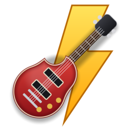
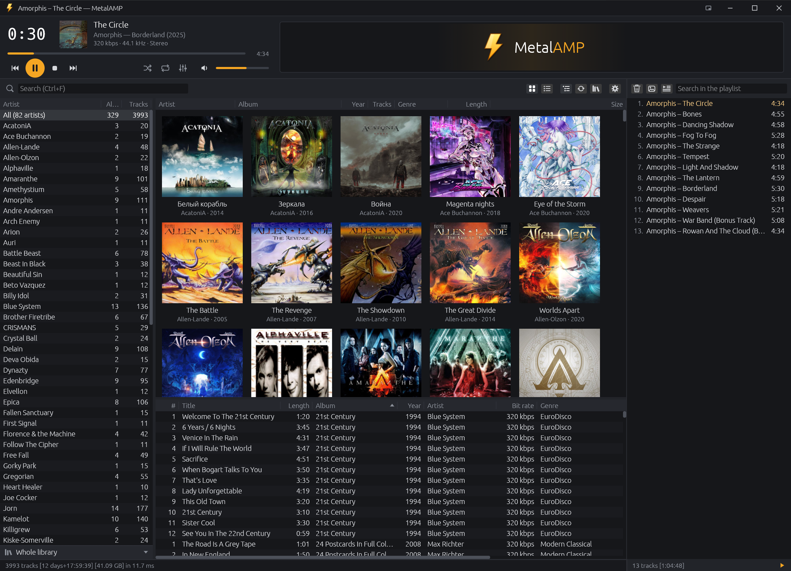

<p align="center">
  
</p>

<h1 align="center">MetalAMP</h1>

<p align="center">Быстрый аудиоплеер с медиабиблиотекой для Windows</p>

<p align="center">
  <a href="https://github.com/Fan4Metal/metalamp/releases/latest"></a>
  
  
  <a href="LICENSE"></a>
</p>

<p align="center"><a href="README.md">English</a> | <b>Русский</b></p>

MetalAMP — аудиоплеер для Windows, построенный вокруг медиабиблиотеки: папки с музыкой сканируются один раз, после чего исполнители, альбомы с обложками и треки показываются сразу и фильтруются по мере набора поискового запроса. Воспроизведение использует декодеры самой Windows (Media Foundation) и вывод звука WASAPI, поэтому программа состоит из одного исполняемого файла без дополнительных библиотек, а альбомы, записанные без пауз, звучат без разрывов.



*Снимок окна версии 0.1.0.*

## Возможности

- **Медиабиблиотека**: исполнители с числом альбомов и треков, сетка обложек альбомов (или таблица), треки; выбор исполнителя сужает альбомы, выбор альбома — треки; представления сужают библиотеку по условиям, жанру или папке, как smart views в Winamp (см. [Библиотека](#библиотека) и [Представления](#представления)).
- **Скорость**: библиотека из 4942 треков показывается из индекса примерно за 12 мс после запуска, проверка папок без изменений занимает около 26 мс, поиск сужает все панели меньше чем за миллисекунду.
- **Воспроизведение без пауз**: следующий трек открывается до конца текущего, а файлы MP3 обрезаются до музыки по тегу LAME (см. [Воспроизведение](#воспроизведение)).
- **Форматы Windows**: MP3, AAC (M4A), FLAC, WMA и WAV через Media Foundation; плейлисты M3U и M3U8.
- **Обработка звука**: одна громкость у всех треков, десятиполосный эквалайзер, улучшение звука, кроссфейд и лимитер; всё выключено по умолчанию (см. [Обработка звука](#обработка-звука)).
- **Визуализации**: анализаторы спектра, хребты, спектрограмма, синтвейв, молнии, вихрь, волна, осциллограф, ноты и пианино (см. [Визуализации](#визуализации)).
- **Плейлист** рядом с библиотекой, сохраняется между запусками, и сохранённые плейлисты (см. [Плейлист](#плейлист)).
- **Статистика библиотеки**: число треков, альбомов, исполнителей и жанров, длительность и размер, прослушивания и диаграммы битрейтов, форматов, годов, жанров, исполнителей и самых слушаемых треков (см. [Статистика](#статистика)).
- **Сведения о файле и теги**: все поля тега трека, обложка и свойства звука в окне, которое открывается щелчком по обложке в панели плеера или `I`; там же правятся теги одного файла или нескольких (см. [Сведения о файле](#сведения-о-файле)).
- **Мини-плеер**: обложка или вращающаяся виниловая пластинка в небольшом окне поверх остальных (см. [Мини-плеер](#мини-плеер)).
- **Одно окно**: файлы, открытые из Проводника, попадают в уже открытое окно.
- **Ассоциации файлов** со своим значком для каждого типа, их предлагает установщик.
- **Интерфейс на русском или английском**: язык следует языку Windows и меняется в окне настроек (`F5`).
- **Портативность**: [портативный архив](#установка) хранит настройки, индекс библиотеки и обложки рядом с программой.
- **Конфиденциальность**: обращений к сети нет, кроме необязательной проверки обновлений (см. [Проверка обновлений и конфиденциальность](#проверка-обновлений-и-конфиденциальность)).

## Установка

Установщик и портативный архив публикуются на странице [Releases](https://github.com/Fan4Metal/metalamp/releases). Нужна Windows 10 версии 1607 или новее (с ней появился декодер FLAC). Исполняемые файлы не подписаны, поэтому SmartScreen при первом запуске может предупредить о неизвестном издателе.

- **Установщик** `MetalAMP_<версия>_Setup.exe`: права администратора не нужны; программа помещается в `%LOCALAPPDATA%\Programs\MetalAMP` и хранит свои данные в `%APPDATA%\MetalAMP\config`. Он может зарегистрировать MetalAMP для аудиофайлов и плейлистов (MP3, FLAC, M4A, AAC, WAV, WMA, M3U), каждый тип со своим значком; программу по умолчанию в Windows выбирает только пользователь, поэтому последняя страница предлагает открыть параметры «Приложения по умолчанию». При удалении программы деинсталлятор спрашивает, удалить ли и её данные.
- **Портативный архив** `MetalAMP_<версия>_portable.zip`: программа в папке `MetalAMP`, работает без установки; данные хранятся рядом с ней, так что программу можно носить на съёмном диске.

<details>
<summary>Что программа хранит и где</summary>

Установленная программа хранит настройки, индекс библиотеки (`library.json`), плейлист (`playlist.m3u8`), сохранённые плейлисты (`playlists`), прослушивания и рейтинги (`stats.json`), замеры громкости (`loudness.json`) и миниатюры обложек (`covers`) в `%APPDATA%\MetalAMP\config`.

В портативном архиве лежит пустой файл `metalamp.json`. Пока он находится рядом с `metalamp.exe` и папка доступна для записи, настройки хранятся в нём, а всё остальное — рядом. Без этого файла всё хранится в `%APPDATA%\MetalAMP\config`, как у установленной программы. Окно «О программе» показывает, где хранятся настройки.

</details>

## Использование

### Библиотека

При первом запуске окно предлагает добавить папку с музыкой: `Ctrl+Shift+O` или **Добавить папку…** в меню папок в строке библиотеки. В библиотеке три панели: исполнители слева, альбомы (обложки или таблица) справа сверху и треки под ними; выбор исполнителя сужает альбомы, выбор альбома — треки. Поле поиска (`Ctrl+F`) сужает все три панели по мере ввода. Двойной щелчок или `Enter` запускает воспроизведение.

<details>
<summary>Чтение папок, индекс, отслеживание папок</summary>

- **Папки**: кнопка папок на панели библиотеки показывает список папок и убирает лишние. Папки читаются в отдельном потоке: теги каждого файла (название, исполнитель, исполнитель альбома, альбом, год, номера трека и диска, жанр, длительность, битрейт), а недостающее в теге берётся из папок в привычной раскладке `Исполнитель\(Год) Альбом\NN - Название.mp3`. Библиотека заполняется по мере чтения; первое чтение 4942 файлов MP3 с жёсткого диска заняло около 50 секунд.
- **Индекс**: результат сохраняется в индексе, поэтому следующие запуски показывают библиотеку сразу и перечитывают только файлы, у которых изменились размер или время.
- **Отслеживание**: пока программа работает, папки отслеживаются: добавленные, изменённые и удалённые файлы учитываются примерно через три секунды после того, как изменения в папках затихнут (скопированный альбом читается один раз, в конце).
- **Перечитывание**: `Ctrl+R` или кнопка на панели перечитывает папки вручную, например после подключения диска. Пункт **Перечитать все теги** в меню папок читает все файлы, в том числе те, у которых не изменились размер и время (теггер может сохранять время файлов).

</details>

<details>
<summary>Как группируются и упорядочиваются альбомы</summary>

Альбомы группируются по исполнителю альбома (иначе по исполнителю) и названию альбома, независимо от годов треков. Когда ни у одного трека альбома в папке нет исполнителя альбома, исполнитель трека его не дробит: сборник (не меньше трёх треков не меньше чем трёх исполнителей, ни у одного больше половины) относится к **Various Artists**, а альбом исполнителя с гостями («A», «A feat. B», «A & C») — к этому исполнителю; год альбома — самый ранний из них. Издания одного альбома в отдельных папках с разными годами (Greatest Hits 1990 и 2005 годов) — разные альбомы; диски одного альбома в отдельных папках остаются одним альбомом. Исполнители упорядочены по имени с числами по значению, альбомы каждого исполнителя — по году.

</details>

<details>
<summary>Панели, колонки, поиск, прослушивания и рейтинги</summary>

- **Исполнители**: имя, число альбомов и треков; строка **Все** сверху показывает всю библиотеку.
- **Альбомы**: обложки с названием и годом (или исполнителем) либо таблица с исполнителем, названием, годом, числом треков, жанром, длительностью и размером; кнопка на панели показывает текущий вид и переключает на другой (правая кнопка на ней открывает оба вида и размер обложек; размер меняет и колесо с `Ctrl` над обложками). Обложка — изображение в папке альбома (`folder`, `cover`, `front`, `albumart`, JPEG или PNG), иначе картинка из тега первого трека; миниатюры хранятся в папке `covers`.
- **Треки**: номер, название, длительность, альбом, год, исполнитель, жанр, битрейт, рейтинг, число прослушиваний, день последнего и день, когда трек попал в библиотеку (у треков старого индекса и первого чтения библиотеки — время файла); играющий трек выделен цветом элементов управления (по умолчанию).
- **Прослушивания и рейтинги**: прослушивание засчитывается, когда трек звучал половину своей длительности или четыре минуты, что наступит раньше (считается время звучания: перемотка и пауза не засчитываются). Рейтинг от одной до пяти звёзд ставится в меню правой кнопки, пункт **Рейтинг**. Прослушивания и рейтинги хранятся в `stats.json` рядом с настройками; файлы музыки не изменяются.
- **Колонки**: щелчок по заголовку колонки сортирует по ней, повторный щелчок меняет порядок, третий возвращает порядок библиотеки; правая граница колонки перетаскивается для изменения ширины (двойной щелчок по ней подгоняет колонку под самый длинный текст, как в списках Windows); заголовок колонки перетаскивается на другое место, чтобы переставить колонку, а правая кнопка на заголовках открывает список колонок, которые можно скрыть или показать, и пункт **Столбцы по умолчанию**. Границы между панелями тоже перемещаются. Колонки, которые не помещаются в панели, прокручиваются по горизонтали (полосой прокрутки или колесом мыши с `Shift`).
- **Поиск**: каждое слово должно встречаться в исполнителе, исполнителе альбома, альбоме, названии, жанре или годе трека; `Esc` очищает поле. Строка состояния показывает число, общую длительность и размер показанных треков и время поиска.
- **Буквы**, набранные при указателе над исполнителями, переходят к первому исполнителю, начинающемуся с них; та же буква ещё раз переходит к следующему.

</details>

<details>
<summary>Воспроизведение, меню, переход к альбому или исполнителю</summary>

- **Воспроизведение**: двойной щелчок или `Enter` запускает исполнителя — его треки, альбом — его треки, трек — всю таблицу начиная с него.
- **Меню**: правая кнопка открывает меню с пунктами **Воспроизвести**, **Воспроизвести следующим** (сразу после играющего трека, и при перемешивании тоже), **Добавить в плейлист** и **Показать в папке**, на альбоме также **Перейти к исполнителю** и **Изменить теги…** (все его треки сразу), на треке также **Перейти к альбому**, **Перейти к исполнителю**, **Рейтинг**, **Изменить теги…** и **Сведения о файле…**.
- **Изменить теги…** (`Ctrl+E`, также в меню плейлиста) открывает окно сведений о файле, где теги выбранных файлов стоят в полях ввода (см. [Сведения о файле](#сведения-о-файле)).
- **Переход к альбому или исполнителю** выбирает их в панелях, прокручивает к ним и выделяет трек, на котором было открыто меню; поиск или представление, которые их скрыли бы, сбрасываются. Клавиши `G` (альбом) и `Shift+G` (исполнитель) делают то же для трека, выбранного в таблице треков или в плейлисте (там, где щёлкнули последним), иначе для играющего.

</details>

### Представления

**Представления** сужают библиотеку до треков, удовлетворяющих набору условий, как smart views в Winamp: строка под исполнителями называет текущее представление (вначале **Вся библиотека**) и открывает меню представлений с пунктами **Новое представление…** и **Изменить…** для текущего. Поиск, панели и строка состояния работают внутри представления; `Ctrl+1` показывает всю библиотеку, `Ctrl+2`…`Ctrl+9` — представления в порядке меню. Представления хранятся в настройках.

<details>
<summary>Условия и пример</summary>

- **У представления** есть название, иконка перед ним (нота, хлопушка, молния, сердце, звезда, часы, диск, микрофон, наушники, глобус или папка) цвета акцента или своего цвета и условия, которые должны выполняться все (или любое из них).
- **Условие** — это поле (жанр, исполнитель, исполнитель альбома, альбом, название, год, папка, битрейт, длительность в минутах, дней с попадания трека в библиотеку, число прослушиваний, дней с последнего прослушивания, рейтинг, обложка в теге), операция (содержит, равно, начинается с, пусто, меньше, в диапазоне, внутри папки…) и значение. Тексты сравниваются без учёта регистра, а у текстовых полей есть меню значений, встречающихся в библиотеке, так что жанр выбирается в том написании, что в тегах.
- **Редактор**, пока открыт, показывает, сколько исполнителей, альбомов и треков оставляют условия.
- **Пример**: представление «Саундтреки» с условием *жанр содержит саундтрек* и представление «Остальное» с условием *жанр не содержит саундтрек* делят библиотеку надвое; исполнитель с альбомами обоих родов попадает в оба представления со своими числами в каждом.

</details>

### Статистика

Кнопка с диаграммой в строке библиотеки (или `F6`) открывает статистику библиотеки: плитки с числом треков, альбомов, исполнителей и жанров, общей длительностью и размером, прослушиваниями и временем звучания, а под ними диаграммы. Каждый столбец и сектор показывает свои числа под указателем; щелчок по исполнителю или треку переходит к нему в библиотеке. Крестик, `Esc`, `Enter` или щелчок вне окна закрывают его.

<details>
<summary>Диаграммы</summary>

- **Битрейт**: треки по битрейту, от меньше 128 кбит/с до 320 и файлов без потерь.
- **Форматы**: доля каждого типа файлов с его размером.
- **Альбомы по годам**: от самого раннего года до самого позднего.
- **Рост библиотеки**: число треков в библиотеке по месяцам, по времени появления их файлов в ней (при первом чтении библиотеки — по времени файлов).
- **Длина треков**: треки по длине в минутах.
- **Жанры** и **Исполнители**: десять с наибольшим числом треков.
- **Прослушивание**: доля библиотеки, сыгранная хотя бы раз, и сыгранные треки по давности последнего прослушивания.
- **Оценки**: треки по числу звёзд.
- **Чаще всего**: десять треков и десять исполнителей, которые слушались чаще всего.
- **Теги**: доля треков, в тегах которых есть год, жанр, исполнитель альбома, номер трека и обложка.
- **Частота дискретизации**: треки по частоте, число стереофонических и монофонических.

</details>

### Сведения о файле

Щелчок по обложке в панели плеера или двойной щелчок по названию трека в ней открывает окно сведений об играющем файле; `I` (или `Alt+3`) и пункт **Сведения о файле…** в контекстных меню треков и плейлиста открывают его для выбранного трека. Кнопка **Изменить** в окне (или `Ctrl+E`) включает правку тегов. Крестик, `Esc`, `Enter` или щелчок вне окна закрывают его.

<details>
<summary>Что показывает окно</summary>

- **Сверху**: обложка (из тега, иначе из папки альбома), название, исполнитель, альбом с годом и жанром, а также формат, длительность, битрейт, частота дискретизации, число каналов и размер.
- **Основное**: основные поля тега в порядке тегеров (название, исполнитель, альбом, исполнитель альбома, композитор, год и жанр, номера трека и диска, комментарий) в рамках, как при правке, и какие теги есть в файле (например, `ID3v2.3 · ID3v1`).
- **Дополнительно**: прочие поля тега (издатель, копирайт, BPM, усиление трека и т. п.), только имеющиеся.
- **Текст песни** в отдельном разделе.
- **Файл**: путь к файлу, задержка и добивка кодировщика из тега LAME у MP3 и картинки тега с их размерами; кнопка **Показать в папке** в заголовке раздела выделяет файл в Проводнике.

Текст можно выделить и скопировать.

</details>

<details>
<summary>Правка тегов, несколько файлов сразу</summary>

- **Изменить** (или `Ctrl+E`) превращает основные поля и прочие поля, имеющиеся в теге, в поля ввода; **Сохранить** (или `Enter`) записывает их, **Отмена** (или `Esc`) отказывается от правки, а щелчок вне окна во время правки его не закрывает. Пункт **Изменить теги…** в контекстных меню треков и плейлиста открывает окно с правкой выбранных файлов.
- **Несколько файлов** показываются по одному, стрелки в углу переходят от файла к файлу, или все сразу (**Все N**): тогда основные поля показывают общее у файлов значение или *(разные)* — такое поле остаётся как есть, пока в него ничего не введено, — а под ними перечислены имена файлов, и щелчок по имени показывает этот файл. Переход к другому файлу во время правки сначала записывает изменённые поля.
- **Что записывается**: только поля, в которые что-то введено; очищенное поле удаляется, несколько значений одного поля разделяются `; `. Остальное в теге (картинки, тексты песен, кадры других программ) сохраняется. Записываются MP3, FLAC, M4A и WAV, WMA — нет.
- **Занятые файлы**: играющий трек и следующий за ним тоже записываются: на время записи плеер отпускает файл и затем продолжает с того же сэмпла, а звук тем временем идёт из буфера. Файл, занятый другой программой, называется с причиной, остальные записываются. Записанные файлы библиотека перечитывает.

</details>

<details>
<summary>Как записываются теги MP3</summary>

Выбирается в окне настроек («Общие», раздел **Теги**):

- **Версия ID3v2**: по умолчанию — как в файле, а файлу без тега — 2.3, которую читают все программы и устройства; либо как в файле, а новым — 2.4; либо всегда 2.3 или 2.4.
- **ID3v1**, короткий тег, который читают старые плееры и магнитолы (пишется в кодировке Windows, кириллица — в Windows-1251), и **APE**, который оставляют foobar2000 и MP3Gain: по умолчанию, если они есть в файле, в них пишутся те же поля, чтобы в них не оставались старые значения; их можно также удалять или не трогать, а ID3v1 — писать в каждый файл.
- Файл без тега ID3v2 получает его с тем, что записано в его тегах APE и ID3v1.

</details>

<details>
<summary>Замена обложки</summary>

- **Обложка крупно**: щелчок по обложке показывает её крупно поверх окна, с размером в пикселях, форматом и размером файла; щелчок, `Esc` или `Enter` закрывают её.
- **Меню обложки**: правая кнопка на обложке (или щелчок, если обложки нет) открывает меню с пунктами **Выбрать картинку…**, картинка папки (например, `cover.jpg`, если она есть в папке) и **Удалить обложку**; то же делает файл JPEG или PNG, перетащенный в окно. Вне правки эти пункты начинают её.
- **Запись**: новая обложка показывается сразу и записывается вместе с полями по **Сохранить** как передняя обложка показанного файла или всех файлов сразу вместо прежней обложки тега; прочие картинки тега (задняя обложка, буклет) сохраняются.
- **Размер**: в том же меню выбирается наибольшая сторона обложки в теге: как есть, 500, 1000 (по умолчанию) или 1500 пикселей; картинка крупнее уменьшается до этого размера и записывается в JPEG, чтобы каждый трек альбома не нёс по нескольку мегабайт. Выбор сохраняется, а новая обложка, ожидающая сохранения, пересчитывается под него; под названием окно показывает размер картинки и размер, в котором она будет записана.
- **Сохранить как folder.jpg** в том же меню сразу записывает показанную обложку в папку файлов (**Заменить folder.jpg**, если такой файл уже есть); сетка альбомов показывает картинку папки раньше картинки из тега, поэтому так меняется и обложка альбома в библиотеке.

</details>

### Окно и панель плеера

У окна два вида (окно настроек, «Общие», **Окно**): с библиотекой (панель плеера, библиотека и плейлист рядом) и **Плеер и плейлист**, как в раннем Winamp. В панели по умолчанию слева плеер, справа визуализация; колесо мыши в любом месте строки заголовка и панели плеера меняет громкость на шаг громкости (по умолчанию 5 %).

<details>
<summary>Панель плеера</summary>

- **Плеер**: прошедшее время крупными цифрами (щелчок переключает его на оставшееся и обратно), обложка (щелчок открывает сведения о файле), название, исполнитель и альбом, битрейт, частота дискретизации и каналы (двойной щелчок по этим строкам тоже открывает сведения о файле); полоса перемотки с длительностью на конце; кнопки «Предыдущий», «Воспроизвести/Пауза», «Стоп» и «Следующий»; перемешивание, повтор (выключен, плейлист, трек), эквалайзер и громкость с кнопкой отключения звука.
- **Кнопка эквалайзера** подсвечена, пока эквалайзер включён, и открывает его в отдельном окне под кнопкой (тот же эквалайзер, что в окне настроек; рядом с крестиком указано, включён ли лимитер, и щелчок по надписи переключает его); окно закрывается крестиком, `Esc` или той же кнопкой.
- **Компактная панель**: в окне настроек вместо обычной можно выбрать панель в одну строку: кнопки, обложка и названия, перемешивание, повтор, эквалайзер и громкость, под ними полоса перемотки с временем.

</details>

<details>
<summary>Вид «Плеер и плейлист»</summary>

Узкое окно со своим плеером сверху (дисплей со временем над визуализацией, номер, исполнитель, название и длительность трека в поле, битрейт и прочее, громкость, полоса перемотки и кнопки) и плейлистом под ним, без библиотеки, строки состояния и обложек; библиотека при этом всё равно читается, ради названий. Двойной щелчок по полю трека открывает сведения о файле. У каждого вида свои размер и место окна. Настройки, сведения о файле и эквалайзер открываются в отдельных окнах, когда окно программы слишком мало для них.

</details>

<details>
<summary>Панель задач, трей, медиаклавиши</summary>

- **Панель задач**: кнопка программы показывает позицию как индикатор прогресса (жёлтый на паузе), а под её миниатюрой есть кнопки «Предыдущий», «Воспроизвести/Пауза» и «Следующий».
- **Трей**: с настройкой **Сворачивать в трей** (окно настроек, «Общие») в области уведомлений остаётся значок: свёрнутое окно уходит с панели задач в него, щелчок по значку возвращает окно, а меню значка содержит «Воспроизведение / пауза», «Стоп», «Предыдущий», «Следующий» и «Выход»; подсказка значка называет играющий трек.
- **Медиаклавиши** клавиатур, гарнитур и пультов управляют плеером и когда активно другое окно, а медиапанель Windows у регулятора громкости показывает трек; в окне настроек их можно ограничить окном плеера или отключить.
- **Поверх всех окон**: `Ctrl+T` держит окно поверх остальных; булавка сохраняется между запусками.

</details>

### Визуализации

Дисплей справа от плеера показывает звучащий сигнал. Щелчок по нему переключает на следующую визуализацию (если в настройках не выключено **Щелчок переключает визуализацию**), а правая кнопка открывает их список, а под ним кружки цветов; у вида с библиотекой и у вида из плеера и плейлиста она своя.

<details>
<summary>Визуализации и их цвета</summary>

- **Анализатор спектра** с пиками, которые задерживаются и опадают: столбцами, светодиодными сегментами, плавной кривой или зеркально от средней линии.
- **Хребты**: спектры последних мгновений линиями одна за другой, как на обложке «Unknown Pleasures».
- **Пласты**: громкость каждой полосы частот во времени линиями одна за другой, бас впереди, бегущие справа: слои горных гряд.
- **Спектрограмма**.
- **Синтвейв**: полёт над сеткой к полосатому солнцу между горами, которые поднимает спектр.
- **Молнии**: разряды из светящегося ядра в такт ударам.
- **Вихрь**: звучащие волны разлетаются от середины закручивающимися и гаснущими следами, а удары выбрасывают их наружу, как в картинах MilkDrop из Winamp.
- **Волна**, бегущая справа, и **осциллограф**.
- **Ноты**: двенадцать нот со сложенными октавами (какие ноты звучат сейчас) или клавиатура **пианино**, клавиши которой подсвечиваются звучащими нотами.
- **Без визуализации**: дисплей показывает название программы (в узком плеере вида «Плеер и плейлист» — ничего); переключатель **Визуализация** в окне настроек выключает визуализацию совсем: дисплей тогда показывает название программы (в узком плеере — ничего) и не отзывается на щелчки.
- **Цвета** выбираются отдельно от темы: оттенки акцента, радуга по частотам, зелёный-жёлтый-красный по уровню, как в Winamp, огонь, цвета обложки играющего трека (до трёх, по частотам, плавно сменяются вместе с треком; для трека без обложки — оттенки акцента) или оттенки своего цвета.

</details>

### Мини-плеер

Кнопка слева от кнопок окна в строке заголовка (или `Ctrl+M`) включает мини-плеер — небольшое квадратное окно поверх всех окон с обложкой играющего трека (без обложки — со значком программы). Двойной щелчок по обложке, `Esc` или `Ctrl+M` возвращают всё окно с его размером и местом.

<details>
<summary>Названия, кнопки, пластинка, окно</summary>

- **Названия**: название и исполнитель видны сверху по центру (строка, которая не помещается даже уменьшенным шрифтом, бежит до конца и обратно, как название в Winamp) на полосе, плавно уходящей в обложку; щелчок по обложке скрывает их, оставляя одну картинку, повторный щелчок возвращает.
- **Кнопки**: пока над окном движется указатель, справа сверху появляется кнопка возврата ко всему окну, а снизу — полоса перемотки, «Предыдущий», «Воспроизведение / пауза», «Следующий» и громкость, сколько помещается по ширине (в самом маленьком окне, 120 точек, — только «Воспроизведение / пауза»; громкость по-прежнему меняет колесо).
- **Обложка или пластинка**: меню правой кнопки на обложке переключает названия и выбирает вид обложки: **Обложка** — квадрат; **Пластинка** — обложка становится этикеткой виниловой пластинки, которая вращается во время воспроизведения, плавно набирая и сбрасывая ход при запуске и остановке; **Пластинка крупно** — то же с этикеткой побольше и более узкой полосой дорожек.
- **Пластинка** круглая, с мягкой тенью, а то, что вокруг неё и в отверстии шпинделя, видно сквозь окно (щелчки там попадают в окна позади); название написано на виниле над этикеткой, исполнитель — под ней, позиция показана кольцом по краю, а при наведении в центре появляется «Воспроизведение / пауза», под ней — кнопка возврата ко всему окну, а в окне побольше — «Предыдущий» и «Следующий» по сторонам.
- **Окно**: обложка перемещает его, и оно прилипает к краям экрана, когда оказывается рядом с ними; края меняют его размер (окно остаётся квадратным). В первый раз мини-плеер появляется в правом нижнем углу экрана, затем — там, где его оставили; режим сохраняется между запусками.

</details>

### Воспроизведение

Файлы декодирует Media Foundation, медиаплатформа Windows, а воспроизводит общий режим WASAPI на устройстве по умолчанию или выбранном в настройках; смена устройства по умолчанию или отключение устройства обрабатываются без остановки. Трек после текущего открывается заранее, поэтому треки одного формата следуют друг за другом без паузы. Кодировщик MP3 добавляет тишину до музыки и после неё; MetalAMP узнаёт её длительность из тега LAME файла и пропускает, поэтому альбом, записанный без пауз, звучит единым целым.

### Обработка звука

Звук по пути к устройству можно обрабатывать; всё это выключено по умолчанию и включается в окне настроек («Звук»). Анализатор спектра показывает результат.

<details>
<summary>Громкость, эквалайзер, улучшение звука, кроссфейд, лимитер</summary>

- **Одна громкость у всех треков**: трек измеряется по EBU R128 в фоне перед первым воспроизведением (замер сохраняется, так что каждый трек читается один раз) и приводится к −18 LUFS, тихий трек поднимается лишь настолько, насколько позволяют его пики.
- **Эквалайзер**: десять классических полос и предусиление, ровный пресет и классические пресеты (рок, поп, классика и остальные) и свои, сохраняемые под именем.
- **Улучшение звука**: четыре регулятора от 0 до 10: бас (полка ниже 100 Гц и гармоники баса, которые на небольших колонках слышны как недоступный им бас), ясность (воздух выше 6 кГц, срезанный фильтром MP3), ширина (шире стереокартина, бас остаётся в центре) и теплота (мягкое скругление пиков, как у плёнки).
- **Кроссфейд** (до 12 секунд, по умолчанию выключен) плавно переводит конец трека в начало следующего; между треками одной папки он не применяется, если не включить это отдельно, так что альбом по-прежнему играет без пауз.
- **Лимитер**: когда включено хоть что-то из этого, лимитер с упреждением после них не даёт звуку клиповать, удерживая пики на −1 dBFS; поднятое предусиление тогда делает громкий трек плотнее, а не громче. Лимитер можно выключить: поднятые полосы и предусиление слышны как подняты, то, что выходит за полную шкалу, обрезает Windows, а нормализация громкости поднимает тихий трек лишь до полной шкалы.

</details>

### Плейлист

Плейлист справа (`Alt+E` показывает и скрывает его) содержит строки «Исполнитель – Название» с длительностью каждой записи и общей длительностью внизу; поле поиска сужает список (по строке, исполнителю, названию и альбому). Двойной щелчок или `Enter` запускает запись. Файлы и папки, перетащенные в окно, добавляются в конец плейлиста: папка — аудиофайлами из неё и её подпапок в том порядке, в каком их показывает Проводник (и запускаются, если ничего не играет); `Ctrl+O` открывает файлы вместо текущего плейлиста. Плейлист сохраняется между запусками.

<details>
<summary>Строка, перетаскивание, меню, обложка</summary>

- **Вид строки** задаётся на странице «Общие» в настройках: готовые варианты (только название, название – исполнитель, с альбомом или годом) или свой шаблон с полями `%artist%`, `%title%`, `%album%`, `%albumartist%`, `%year%`, `%track%`, `%disc%`, `%genre%` и `%filename%`, где часть в квадратных скобках показывается, только если в ней есть хоть одно поле (`[%artist% – ]%title%`, по умолчанию); номера и длительность можно скрыть.
- **Перетаскивание**: треки (выделенные) и альбомы (из таблицы или из обложек) перетаскиваются из библиотеки в плейлист, в место, которое показывает линия. Записи выделяются с `Ctrl` и `Shift`, перетаскиваются на другое место, удаляются клавишей `Delete`.
- **Меню**: в меню правой кнопки есть также **Воспроизвести следующим** (записи переносятся сразу за играющей), **Перейти к альбому** и **Перейти к исполнителю**: они показывают альбом или исполнителя записи в библиотеке.
- **Обложка** играющего трека показывается под списком во всю ширину панели; кнопка с картинкой в строке плейлиста скрывает её, а щелчок по обложке открывает сведения о файле.

</details>

<details>
<summary>Сохранение между запусками, сохранённые плейлисты, файлы M3U</summary>

- **Между запусками** плейлист сохраняется в `playlist.m3u8` вместе с играющим треком и местом в нём: первое воспроизведение после запуска продолжается оттуда (другой выбранный трек начинается с начала; остановленный трек начинается заново).
- **Плейлисты M3U и M3U8** открываются как список их записей.
- **Сохранение**: кнопка плейлистов в строке плейлиста сохраняет список под именем или в выбранный файл. Сохранённые плейлисты — файлы M3U8 в папке `playlists` рядом с настройками, их открывают и другие плееры.
- **Меню плейлистов** перечисляет сохранённые плейлисты и плейлисты M3U и M3U8, найденные в папках библиотеки, с числом треков у каждого: щелчок открывает плейлист вместо текущего списка и запускает его, крестик удаляет сохранённый; плейлист из папок библиотеки, помеченный M3U или M3U8, крестик только убирает из списка, а файл остаётся на месте; меню возвращает убранные.

</details>

### Настройки

Окно настроек (`F5`, или `Ctrl+P`, или шестерёнка в строке библиотеки) перечисляет страницы слева: **Общие**, **Звук**, **Горячие клавиши** и **Обновления**. Кнопка **Сбросить** возвращает настройкам значения по умолчанию.

<details>
<summary>Общие</summary>

- **Интерфейс**: язык; тема (пять тёмных и две светлые, от чёрной до белой); цвет элементов управления (девять готовых или свой, выбранный на цветовом круге или введённый как HEX, RGB или HSL); цвета выделения и играющего трека (каждый из цвета элементов, серый, сланцевый, синий, бирюзовый, фиолетовый или свой; у играющего трека ещё самый яркий, белый в тёмной теме); вид окна и панели плеера (см. [Окно и панель плеера](#окно-и-панель-плеера)); визуализация и её цвета (см. [Визуализации](#визуализации)).
- **Плейлист**: вид строки записи, номера и длительность (см. [Плейлист](#плейлист)).
- **Воспроизведение**: шаг перемотки (по умолчанию 5 секунд, 1–60 с) и шаг громкости (по умолчанию 5 %, 1–25 %).
- **Медиаклавиши**: всегда, только в окне плеера или выключены; **Сворачивать в трей**.
- **Теги**: как записываются теги MP3 (см. [Сведения о файле](#сведения-о-файле)).

</details>

<details>
<summary>Звук</summary>

- **Устройство вывода**: устройство Windows по умолчанию, которое следует выбранному в Windows, или одно из имеющихся; выбранное устройство, которого нет при запуске трека, подменяется устройством по умолчанию, пока оно не вернётся.
- **Громкость** (нормализация и лимитер), **Между треками** (кроссфейд), **Эквалайзер** и **Улучшение звука** (см. [Обработка звука](#обработка-звука)).

</details>

<details>
<summary>Горячие клавиши и обновления</summary>

- **Горячие клавиши**: см. [Изменение клавиш](#горячие-клавиши).
- **Обновления**: проверка обновлений (см. [Проверка обновлений и конфиденциальность](#проверка-обновлений-и-конфиденциальность)).

</details>

## Горячие клавиши

Ниже приведены клавиши по умолчанию; клавиши действий плеера можно изменить в окне настроек (**Горячие клавиши**), а подсказки показывают клавиши, назначенные сейчас. Клавиши списков (стрелки, `Enter`, `Delete`), стрелки над панелью плеера и буквы над исполнителями не меняются.

<details open>
<summary>Воспроизведение и звук</summary>

| Клавиша | Действие |
|---|---|
| `Пробел`, `C` | Воспроизведение / пауза |
| `X` | Воспроизвести |
| `V` | Стоп |
| `Shift+V` | Стоп после текущего трека (повторно — играть дальше как обычно); кнопка «Стоп» в это время подсвечена, пункт есть и в меню плейлиста |
| `Ctrl+Вправо`, `B` | Следующий трек |
| `Ctrl+Влево`, `Z` | Предыдущий трек (начало текущего после его первых 3 секунд) |
| `Shift+Вправо` / `Shift+Влево`, или `Вправо` / `Влево` с указателем над панелью плеера | Вперёд / назад на шаг перематывания (по умолчанию 5 секунд; **Шаг перемотки** в окне настроек, «Общие», 1–60 с) |
| `Ctrl+Вверх` / `Ctrl+Вниз`, или `Вверх` / `Вниз` с указателем над панелью плеера | Громкость выше / ниже на шаг громкости (по умолчанию 5 %; **Шаг громкости** в окне настроек, «Общие», 1–25 %) |
| `M` | Без звука |
| `R` | Повтор: выключен, плейлист, трек |
| `S` | Перемешать |
| Медиаклавиши | «Воспроизведение / пауза», «Стоп», «Предыдущий» и «Следующий» клавиатуры, гарнитуры или пульта, и когда активно другое окно; в окне настроек их можно ограничить окном плеера или отключить |

</details>

<details>
<summary>Библиотека и плейлист</summary>

| Клавиша | Действие |
|---|---|
| `Ctrl+F` | Поиск в библиотеке |
| `Ctrl+1` … `Ctrl+9` | Вся библиотека (`1`) или одно из её представлений в порядке меню представлений |
| `Ctrl+O` | Открыть файлы |
| `Ctrl+Shift+O` | Добавить папку с музыкой |
| `Ctrl+R` | Перечитать папки библиотеки |
| `Alt+E` | Показать или скрыть плейлист |
| `I`, `Alt+3` | Сведения о выбранном файле (или об играющем) |
| `Ctrl+E` | Изменить теги выбранных треков (в плейлисте, если по нему щёлкнули последним) |
| `G`, `Shift+G` | Перейти к альбому, к исполнителю выбранного трека (иначе играющего) |
| Стрелки, `Page Up`, `Page Down`, `Home`, `End` | Перемещение в панели, по которой щёлкнули последней |
| Буквы при указателе над исполнителями | Переход к первому исполнителю, начинающемуся с них (та же буква ещё раз переходит к следующему) |
| `Enter` | Воспроизвести выделенное |
| `Delete` | Убрать из плейлиста |
| `Ctrl` + колесо над обложками | Крупнее или мельче обложки (также правой кнопкой по кнопке обложек в строке библиотеки: четыре размера и бегунок) |

</details>

<details>
<summary>Окно и программа</summary>

| Клавиша | Действие |
|---|---|
| `Ctrl+M` | Мини-плеер: обложка с минимумом кнопок поверх всех окон (повторно или `Esc` — снова всё окно); также кнопка слева от кнопок окна |
| `Ctrl+T` | Окно поверх всех окон (повторно — больше нет) |
| `F1` | О программе (также щелчок по значку в строке заголовка) |
| `F6` | Статистика библиотеки (также кнопка с диаграммой в строке библиотеки) |
| `F5`, `Ctrl+P` | Настройки (также шестерёнка в строке библиотеки) |

</details>

<details>
<summary>Изменение клавиш</summary>

На странице **Горячие клавиши** окна настроек перечислены все действия плеера с их клавишами:

- Щелчок по клавише ждёт нажатия новой на её место, **+** добавляет ещё одну (в том числе боковую кнопку мыши), крестик убирает клавишу.
- Клавиша, которая была у другого действия, переходит к этому, о чём страница сообщает, предлагая **Отменить**.
- Круглая стрелка возвращает действию клавиши по умолчанию, а **Сбросить клавиши** возвращает все.
- Поле поиска находит действие по названию или клавише.

</details>

## Проверка обновлений и конфиденциальность

Проверка обновлений необязательна и по умолчанию выключена. Если на странице «Обновления» окна настроек включён переключатель **Проверять при запуске**, программа не чаще раза в день запрашивает у GitHub Releases API (`api.github.com`) последний выпуск; кнопка **Проверить сейчас** в том же окне делает запрос сразу. Запрос не содержит ничего, кроме версии программы в заголовке `User-Agent`, и ничего не скачивает и не устанавливает: при наличии нового выпуска в строке заголовка появляется кнопка с его версией, открывающая страницу выпуска в браузере. В остальном программа к сети не обращается.

## Сборка

Требования: Windows 10 или новее, стабильный Rust (цель MSVC, редакция 2024) и Visual Studio 2022 Build Tools с компонентами C++. Для `build.py` нужен [uv](https://docs.astral.sh/uv/).

```
uv run build.py          # target\release\metalamp.exe
cargo test
```

<details>
<summary>Как устроена сборка, встроенные замеры</summary>

`build.py` сначала закрывает `metalamp.exe`, запущенный из папки `target` проекта (иначе файл заблокирован), затем выполняет `cargo build --release`. Если программа не запущена, достаточно обычного `cargo build --release`. Исполняемый файл линкует среду выполнения C статически (`.cargo/config.toml`), поэтому ничего, кроме самой Windows, ему не нужно.

Встроены три замера: `metalamp --bench scan <папка>` читает папку как при первом сканировании и печатает время этапов, `metalamp --bench gapless <файл.mp3>` сравнивает то, что выдаёт декодер, с тегом LAME файла, а `metalamp --bench loudness <файл>` измеряет громкость файла (EBU R128), его пик и усиление нормализации.

</details>

## Установщик и выпуск

Скрипт выпуска собирает исполняемый файл, установщик и портативный архив. Для него нужен [Inno Setup 6](https://jrsoftware.org/isinfo.php).

```
python tools/make_release.py              # тесты, release-сборка, установщик, архив
python tools/make_release.py --no-tests   # то же без cargo test
python tools/make_release.py --install    # затем тихая установка поверх установленной копии
```

<details>
<summary>Порядок выпуска</summary>

Скрипт записывает файлы в `dist`, версия берётся из `Cargo.toml`. Скрипт установщика — `tools/setup.iss`; значок установщика записывает `metalamp.exe --export-icon <файл.ico>`, а `metalamp.exe --register` / `--unregister` регистрируют типы файлов для текущего пользователя (их запускает установщик).

Выпуски на GitHub собирает рабочий процесс **Release** (`.github/workflows/release.yml`). После обновления версии в `Cargo.toml` и коммита отправка соответствующего тега публикует выпуск с установщиком и портативным архивом:

```
git tag v0.1.0
git push origin v0.1.0
```

Рабочий процесс останавливается, если тег не совпадает с версией в `Cargo.toml`. Ручной запуск (Actions → Release → Run workflow) собирает файлы и прикрепляет их к запуску, не создавая выпуск.

</details>

## Используемые проекты

MetalAMP построен на следующих проектах с открытым исходным кодом:

- [egui / eframe](https://github.com/emilk/egui): интерфейс и окно программы;
- [lofty](https://github.com/Serial-ATA/lofty-rs): чтение тегов и свойств звука;
- [image](https://github.com/image-rs/image): декодирование обложек и запись их миниатюр;
- [walkdir](https://github.com/BurntSushi/walkdir) и [rayon](https://github.com/rayon-rs/rayon): обход папок и параллельное чтение тегов;
- [serde](https://serde.rs) и [serde_json](https://github.com/serde-rs/json): настройки и индекс библиотеки;
- [windows-rs](https://github.com/microsoft/windows-rs): Media Foundation, WASAPI и Win32 API;
- [rfd](https://github.com/PolyMeilex/rfd): диалоги выбора файлов и папок;
- [Inno Setup](https://jrsoftware.org/isinfo.php): установщик.

## Лицензия

MIT, см. [LICENSE](LICENSE). Библиотеки, вошедшие в программу, и шрифты интерфейса сохраняют свои лицензии: [licenses/THIRD_PARTY_NOTICES.txt](licenses/THIRD_PARTY_NOTICES.txt); их показывает кнопка **Лицензии…** в окне «О программе», и они входят в установщик и портативный архив.
